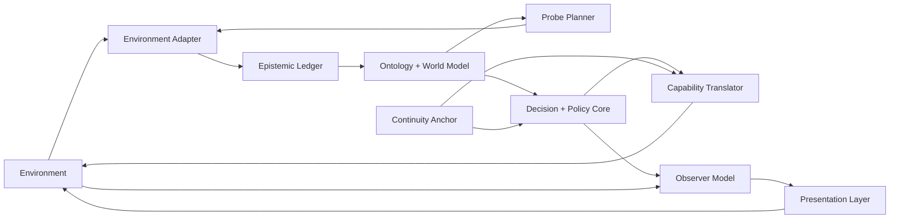
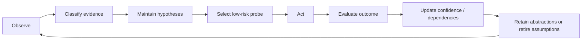
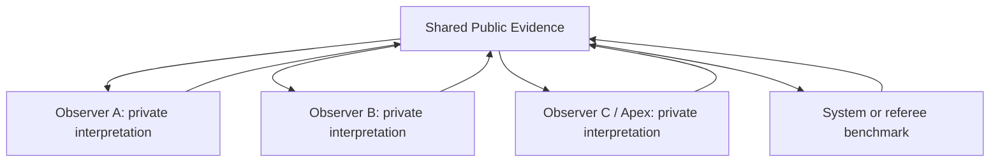

# Preliminary Integration Architecture for Uncertainty-Adaptive Entities in Virtual Environments

**Independent Version v0.1**  
**Document ID:** UAE-PIA-CHATGPT-2026-10-11-v0.1  
**Prepared by:** ChatGPT (OpenAI) - GPT-5.6 Sol  
**Date:** October 11, 2026  
**Status:** Preliminary independent architecture; not canonical.

> Research boundary: This document models fictional/authorized simulation behavior. It does not provide instructions for real anti-cheat bypass, memory manipulation, packet falsification, intrusion, or security evasion.

## Executive Summary

This document proposes a preliminary integration architecture for a system-agnostic entity that can enter an unfamiliar virtual environment, begin with incomplete knowledge, learn local rules from evidence, translate persistent capabilities into local forms, and adapt its behavior while explicitly representing uncertainty. The central research objective is not unlimited power. It is epistemic operation: how an entity distinguishes what it knows from what it merely suspects, chooses information-gathering actions, manages conflicting evidence, preserves continuity across domains, and avoids treating early guesses as facts.

The architecture synthesizes the strongest ideas from six independently generated responses while remaining an independent design. The resulting system separates five kinds of state: true internal state, locally operative state, presented state, observer-inferred state, and realized outcome. It also adds an explicit epistemic ledger, hypothesis ensemble, active-learning probe planner, evidence-coherence controller, suspicion model, and cross-environment abstraction memory. These additions make the design suitable for controlled research into uncertainty rather than only for power-fantasy roleplay.

A critical design boundary is maintained throughout. Terms such as masking, inversion, Mirror of Mists, veil, observer facade, or outcome authority are treated only as fictional simulation mechanisms or narrative abstractions. This document does not specify real anti-cheat bypass, memory manipulation, packet falsification, intrusion, or evasion of platform security. Where source responses proposed such mechanisms, this architecture deliberately replaces them with environment-authorized simulation interfaces.

The preliminary architecture is intentionally modular. An environment adapter handles local inputs; an epistemic subsystem tracks confidence and contradictions; an ontology subsystem discovers the environment's concepts; a world model predicts consequences; a capability translator maps persistent functions into local mechanics; a policy core selects actions; an observer model tracks what other entities can know; and a presentation layer produces coherent observer-relative appearances without contradicting shared public evidence. An evaluation loop then compares prediction to result and updates the model.

## 1. Concept Overview

The core concept is a portable virtual entity whose identity survives changes in genre, mechanics, platform, vocabulary, and representation. The entity is not defined as a fixed collection of RPG statistics. Instead, it possesses invariant functions - for example persistence, protection, mobility, perception, influence, learning, and strategic intent - that must be translated into whatever mechanisms actually exist in the host environment.

When the entity arrives in a new environment, it does not assume that concepts such as health, armor, mana, currency, levels, inventory, or even character ownership exist. It treats those as hypotheses. Its first task is to learn the environment's ontology: which entities exist, which variables matter, which actions are possible, what counts as success or failure, what information is visible, and how state changes occur.

The design therefore treats uncertainty as a first-class system state. Every important proposition about the environment is labeled by epistemic status and evidence provenance. The entity can act while uncertain, but it must know that it is uncertain. Its adaptation loop is evidence-driven rather than omniscient: observe, classify, hypothesize, select a low-risk probe, act, evaluate, update, and retain only what continues to survive testing.

Observer-relative presentation is included because it creates a useful uncertainty problem. Different observers may possess different evidence and therefore reach different conclusions about the same entity. The architecture permits private interpretations to differ while imposing a coherence constraint on shared evidence. This turns the original masking idea into a testable information-modeling problem rather than an unconditional invisibility power.

## 2. Purpose of This Document

The purpose of this document is to define a preliminary integration architecture that the research team can independently review, challenge, simulate, and compare with other versions. It is not a final implementation specification and does not claim that the architecture is canonical. Its value is in making assumptions explicit enough that they can fail under test.

The immediate research question is: how should an adaptive entity operate when it begins with incomplete, uncertain, or contradictory information about the environment in which it must act? Secondary questions include how the entity should represent confidence, how it should select probes, how it should transfer knowledge between domains without overgeneralizing, how it should maintain coherent public evidence across multiple observers, and what should happen when its desired outcome conflicts with established rules.

A further purpose is integration. The source responses used different vocabularies - Parallax, Mirrorwalker, Dynamic Inversion Anomaly, Quiet Exception, Veiled Constant, and Echo - but many described compatible subsystems. This document normalizes those ideas into a common architecture so that later versions can compare components rather than names.

## 3. Conversation History Summary

The initiating request asked for a character that could be placed into essentially any gaming environment without prior understanding of the game, learn from supplied information, adapt and evolve, present an observer-relative profile, and still realize the user's intended in-simulation outcomes. The prompt also borrowed fictional concepts such as masking, inversion, and the Mirror of Mists as metaphors for concealment and perception management.

The ChatGPT response developed The Parallax and separated true, presented, observed, effective, and realized state. It emphasized ontology discovery, low-risk active learning, function-based capability translation, observer-relative masking, a true capability reserve, minimum-anomaly outcome selection, adaptation, failure modes, and cross-environment memory. This was the most explicit state-separation architecture in the source set.

Claude's Mirrorwalker version compressed the idea into a turn-by-turn simulation protocol: adaptation core, mirror veil, inversion, a hidden ledger, and a concise environment model. Its strength was operational simplicity, although it treated records and scans as uniformly observer-relative without fully resolving conflicts between private perceptions and shared evidence.

Gemini's Dynamic Inversion Anomaly emphasized telemetry and arbitrary outcome rendering. Some of its mechanisms crossed from fictional abstraction into real anti-cheat and technical evasion language. Those implementation details are intentionally excluded here. The reusable idea retained from that response is the separation between local outward plausibility and an internal intent-driven resolution layer.

Perplexity's Quiet Exception added several important controls: known/inferred/unknown labels, explicit public-evidence coherence, per-category observer-relative tiers, a distinction between scans and witnessed outcomes, suspicion tracking, two outcome modes, and the rule that contradictions should be surfaced rather than silently erased. These are central to the present architecture.

Microsoft Copilot's Veiled Constant contributed an authorized-use boundary, a stable continuity anchor, visible/operative/reserve capability profiles, adaptation constraints, costs, and an explicit refusal to equate desired outcome with automatic guaranteed success under constrained play. Its staged integration sequence maps well onto an implementable system architecture.

Grok's Echo emphasized portability, minimal initial knowledge, a relative observer facade, and the idea that only explicitly supplied environmental information should be assumed. Its real anti-cheat concealment language is not carried forward. Instead, the architecture retains the useful concept of complete local translation while moving all presentation behavior into the fictional simulation layer.

The independent synthesis therefore keeps the shared adaptive core but changes the research emphasis: uncertainty management becomes the central mechanism; observer-relative presentation becomes a consistency problem; desired outcomes become mode-dependent; and every major subsystem receives explicit failure and validation criteria.

## 4. Problem Statement and Research Framing

A portable entity faces a domain-shift problem. Rules, representations, and causal structures that were valid in one environment may be irrelevant or actively misleading in another. A system that blindly imports prior mechanics will hallucinate nonexistent resources, misread interface conventions, or apply a previously useful tactic where its preconditions do not exist.

The architecture must therefore solve two problems simultaneously. First, it must infer enough of the current environment to act effectively. Second, it must control the damage caused by being wrong. The second problem is what makes uncertainty engineering essential. A strong adaptive system is not one that never makes a wrong inference; it is one that knows which beliefs are weak, chooses reversible tests, notices contradictions, and can recover without rewriting history.

This framing also changes what 'evolution' means. Evolution is not merely accumulation of higher stats. It includes improved ontology mappings, better causal models, refined confidence estimates, lower-cost probes, stronger transfer abstractions, improved observer models, and better identification of where prior knowledge should not transfer.

## 5. Scope, Boundaries, and Non-Goals

The intended scope is fictional games, AI-run simulations, tabletop-like environments, research sandboxes, authored virtual worlds, or authorized private environments where the simulation controller can define the rules. The architecture can model character perception, hidden state, observer-relative interpretation, narrative outcome resolution, and adaptive learning within those spaces.

The architecture does not include procedures for defeating real anti-cheat software, altering protected memory, falsifying network traffic, bypassing server validation, evading moderation, concealing unauthorized code, or manipulating external live-service systems. Any source concept that would require such behavior is represented here as a simulation-level abstraction controlled by the authorized environment or game master.

The architecture is also not a claim of universal solvability. Some environments may be partially observable, adversarial, stochastic, inconsistent, non-stationary, or deliberately deceptive. Desired outcomes may be mutually incompatible with hard constraints. A central requirement of this design is that the entity may report unresolved uncertainty or impossibility rather than fabricating a solution.

## 6. Architectural Design Principles

First, ignorance must be explicit. On entry, the entity begins with an empty or minimal local model and a set of portable abstractions. It may possess learning machinery and persistent identity, but it does not begin with hidden knowledge of the host environment unless that knowledge is explicitly supplied.

Second, state types must not collapse into one another. What the entity truly is, what it can presently express under local rules, what it presents to an observer, what the observer concludes, and what event eventually occurs are distinct variables. Mixing them creates contradictions that cannot be diagnosed.

Third, evidence outranks convenience. When an observed event contradicts the current model, the architecture records the contradiction. It does not silently rewrite the event to preserve the model. This allows adversarial testing and prevents the system from becoming unfalsifiable.

Fourth, adaptation should minimize irreversible exposure. When several probes can reduce uncertainty, prefer the one with the greatest expected information gain relative to cost, risk, resource consumption, and public observability.

Fifth, cross-domain transfer occurs at the level of abstractions and causal motifs, not interface details. The entity may transfer the concept that recovery windows create vulnerability, but it should not transfer the belief that a particular button always performs a dodge.

Sixth, presentation must remain coherent with shared evidence. Private interpretations can differ, but a publicly visible item, common event log, or shared record must have a stable representation unless the environment explicitly models personalized realities.

Seventh, there must be more than one play mode. Research-oriented constrained play treats desired outcomes as goals subject to rules and uncertainty. Sovereign-fiction mode permits the simulation controller to guarantee an authored result, but the guarantee is declared at the mode level rather than disguised as evidence that the entity learned or earned the result.

Eighth, every exceptional behavior should have a diagnostic path. If a component fails, the architecture should identify which assumption, mapping, or state transition failed rather than attributing everything to a single all-purpose power.

## 7. Preliminary Integration Architecture

The proposed architecture consists of interacting modules rather than a single monolithic adaptive agent. The high-level relationship among these modules is shown in Exhibit 1. The purpose of modularization is not merely software convenience; it allows uncertainty, presentation, planning, and continuity to fail independently and therefore to be tested independently.

The Environment Adapter is the boundary between local representation and the entity's internal representation. It accepts observations, actions, event outcomes, rules text, or narrator-provided facts and normalizes them into a common event form. On the outbound side, it converts internal action intents back into locally meaningful actions. The adapter must be replaceable because a turn-based strategy game, a first-person simulation, and a text adventure may expose radically different observation and action structures.

The Continuity Anchor stores identity-level invariants: the entity's persistent designation, objectives, values, learning preferences, risk posture, and transferable abstractions. It does not store local game mechanics as universal facts. This is what allows the entity to remain 'the same' while changing class, body, equipment, scale, or vocabulary.

The Epistemic Ledger is the core uncertainty store. Every proposition is associated with an epistemic status, confidence descriptor, provenance, last update, supporting evidence, contradicting evidence, and dependencies. The ledger separates direct observations from inferred rules and from unsupported possibilities. It also allows a belief to become deprecated rather than deleted so that later analysis can explain why a decision was made.

The Ontology Induction Engine determines which concepts the environment actually contains. It groups observations into candidate entities, variables, actions, resources, constraints, and relations. It can propose that two different labels serve the same function, or that a familiar concept has no local equivalent. This subsystem should prefer sparse ontologies early: inventing fewer concepts reduces the cost of being wrong.

The Hypothesis Ensemble maintains multiple explanations when evidence is insufficient to choose one. If an object might be ammunition, currency, healing, or crafting material, the system should not collapse immediately to one answer. The ensemble preserves alternatives, assigns provisional plausibility, tracks discriminating observations, and identifies which future evidence would separate the hypotheses.

The Probe Planner chooses information-gathering actions. A probe can be passive observation, a reversible interaction, a low-value resource expenditure, a request for clarification, or an intentionally small trial. The planner evaluates potential probes by expected information gain, reversibility, risk, cost, detectability within the fiction, and strategic opportunity cost. In a research implementation, the probe planner is one of the best places to measure whether the system is genuinely uncertainty-aware.

The World Model converts accepted and provisional beliefs into predictions. It represents causal relations, state transitions, resource dependencies, actor capabilities, and uncertainties. Importantly, it can output a range of predicted consequences rather than one deterministic prediction. This gives the policy core a way to choose robust actions when exact mechanics remain unknown.

The Capability Translator maps persistent functions from the Continuity Anchor into local mechanisms discovered by the ontology. 'Protection' might become armor, shields, evasiveness, diplomatic immunity, unit redundancy, or a defensive card. If no credible local mapping exists, the capability remains in reserve rather than being forced into an unnatural form. This is a key distinction between translation and arbitrary power injection.

The Decision and Policy Core selects actions using the current world model, user objective, uncertainty state, mode, and risk posture. It can choose exploitative actions that pursue immediate goals or exploratory actions that reduce uncertainty. The architecture should make that tradeoff explicit. A system that only pursues the next reward may never learn enough to survive a later domain shift.

The Observer Model represents what other entities, referees, or simulation processes know or believe. Each observer receives a knowledge state derived from its access to evidence. The model tracks observer capabilities, observed history, inferred tier, suspicion, and whether the observer shares evidence with others. This subsystem prevents the presentation layer from assuming that every observer is an isolated sensor.

The Presentation Layer is a fictional simulation-level mechanism for observer-relative interpretation. It can apply the original '+1 tier unless the observer is already at the apex, then -1 tier' rule where the environment actually has ordered tiers. In continuous or non-tiered domains it instead maps to a modest qualitative advantage. Presentation cannot arbitrarily rewrite shared public facts; when relative presentation conflicts with public evidence, the architecture preserves evidence and expresses the difference through interpretation, demeanor, confidence, condition, or other locally valid ambiguity.

The Outcome Resolver separates authored outcome control from learned mechanics. In constrained play, it resolves actions according to the current model and environment rules, including failure or partial success. In sovereign fiction, the controller may guarantee a desired event, but the resulting explanation is labeled as authored resolution rather than evidence that the agent discovered a secret rule. This protects the epistemic ledger from contamination by narrative convenience.

The Evaluation and Update subsystem compares predicted consequences with actual results. Surprise is not treated as an error to hide; it is information. Large prediction errors can lower confidence, split a hypothesis, trigger ontology revision, mark a rule as context-dependent, or initiate a new probe cycle.

## 8. Uncertainty Representation and Epistemic Control

The architecture uses categorical epistemic states rather than pretending that every belief has a precisely calibrated probability. A proposition may be directly observed, strongly supported, provisionally inferred, merely possible, contradicted, or deprecated. A numeric confidence score can be added for ranking, but it must not be presented as a true statistical probability unless the implementation has been calibrated for that interpretation.

Each belief should also carry provenance. Provenance answers where the belief came from: direct user-provided rule, direct environmental observation, repeated correlation, analogy to another environment, observer testimony, model inference, or inherited cross-environment abstraction. Two beliefs with the same confidence but different provenance may deserve different testing priorities.

Dependencies matter because uncertainty propagates. If the system infers that an item is a healing resource and then infers an optimal inventory strategy based on that classification, both beliefs should be linked. If the item classification is later contradicted, dependent strategies can be invalidated automatically rather than remaining silently active.

Contradiction is a first-class event. The system records which observation conflicts with which proposition, whether the conflict can be explained by context, and whether the rule should be narrowed rather than discarded. For example, 'this attack always penetrates armor' may become 'this attack penetrates unshielded armor under condition X.' This is model refinement rather than failure concealment.

Unknowns should be ranked by decision relevance. The entity does not need to learn the entire environment before acting. It needs to reduce uncertainty around variables that materially affect the current objective, survival, irreversible commitments, or future learning capacity. This creates an uncertainty budget: attention is allocated to questions whose answers can change action selection.

## 9. Observer-Relative Presentation as an Information Problem

The original relative-tier rule is useful because it forces the architecture to reason about perspective. For each comparable category, the system can estimate an observer's local standing and construct an apparent profile one meaningful tier above that standing. If the observer is already at the maximum recognized tier, the apparent profile moves one tier below to avoid inventing an impossible category. The rule is applied per category rather than treating one apex item as evidence that the observer is apex in every dimension.

The rule becomes more challenging when several observers are present. If every observer sees a different private character sheet, their later conversation may expose contradictions. The architecture therefore distinguishes private interpretation from shared evidence. A private judgment such as 'that person seems more skilled than me' can differ by observer. A publicly visible weapon model, common scoreboard, or jointly inspected record cannot simultaneously hold incompatible values unless the environment explicitly supports personalized perception.

Suspicion is therefore modeled separately from detection. An observer may be unable to identify the internal cause of an extraordinary result while still becoming suspicious because repeated outcomes do not fit the cover profile. The system tracks what each observer has witnessed, what alternative explanations remain plausible, and whether accumulated evidence is straining the presentation model.

This produces a useful research tension: concealment and conspicuous success are not always jointly satisfiable. In constrained play, the entity may choose a less conspicuous action, accept a minor setback, or delay a display. In sovereign fiction, the controller may still author the desired result, but the architecture should allow suspicion to rise rather than pretending the result had no informational consequences.

## 10. Action Selection Under Uncertainty

Action selection combines goal pursuit with information gathering. Every candidate action can be evaluated on at least five dimensions: expected progress toward the objective, downside if the current model is wrong, information gained from the result, reversibility, and resource cost. The policy core should prefer actions that are robust across several plausible world models when stakes are high.

When uncertainty is low and consequences are reversible, the system can exploit known mechanics aggressively. When uncertainty is high and consequences are irreversible, the system should shift toward observation, clarification, or low-risk probes. This is not universal risk aversion; it is risk proportionality based on the cost of model error.

The architecture also supports explicit risk postures. A conservative research mode can prioritize knowledge integrity and reversibility. A balanced mode can trade some uncertainty for progress. A power-fantasy mode can bias strongly toward the user's intended result while still tracking which parts of the outcome were authored rather than inferred. Keeping these modes explicit allows team members to compare results without confusing different adjudication philosophies.

## 11. Cross-Environment Learning and Transfer

Cross-environment memory stores abstractions with applicability conditions. A useful abstraction is not 'weapon X has damage 50'; it is 'some environments expose recovery windows after high-commitment actions.' The latter can generate a hypothesis in a new environment without being asserted as fact.

Transfer should be gated by similarity evidence. The system can use prior abstractions to propose hypotheses more efficiently, but the epistemic ledger marks their origin as transferred rather than locally confirmed. Negative transfer - importing a useful old rule that is false here - is expected and should be measurable.

The system should also support forgetting or deactivation. A continuously growing memory that never retires obsolete abstractions will become less adaptive over time. Deprecated beliefs remain auditable, but they should not participate in active planning unless new evidence revives them.

## 12. Failure, Recovery, and Adversarial Testing

The architecture is designed to fail visibly. Candidate failures include incorrect ontology induction, overconfident inference, probe selection that reveals too much or costs too much, capability translation with no valid local equivalent, observer-model divergence, public-evidence contradiction, negative transfer, hidden non-stationary rules, deception by another entity, and conflicts between desired outcomes and hard constraints.

Recovery begins by localizing the failure. Was the observation wrong, the interpretation wrong, the causal model wrong, the translation wrong, the observer model incomplete, or the environment itself changed? Different diagnoses require different remedies. A monolithic 'adaptation failed' label is not enough for research.

Adversarial testing should include entities that deliberately generate misleading evidence, environments that change rules mid-session, observers that compare notes, non-tiered systems where the relative rule cannot be applied literally, and scenarios where two high-confidence beliefs become mutually inconsistent. A strong architecture should not merely survive these cases; it should produce a trace explaining how its uncertainty state changed.

## 13. Integration Contract and Conceptual Interfaces

A future implementation should expose clean conceptual interfaces between modules. The Environment Adapter should emit normalized observations and accept action intents. The Epistemic Ledger should support assertion, evidence attachment, contradiction, dependency, confidence revision, and provenance queries. The Ontology Engine should propose and retire concepts. The Probe Planner should request candidate discriminating actions from the policy core. The Observer Model should query access to evidence rather than receiving omniscient world state by default.

The architecture should maintain separate ledgers for environment truth as currently modeled, entity internal state, public evidence, observer-specific beliefs, and authored controller decisions. These stores may refer to the same event but must not be silently merged. This separation is especially important when sovereign-fiction resolution is enabled, because authored outcomes should not automatically become evidence for an inferred environmental law.

A simulation turn can therefore be represented conceptually as: ingest evidence; update epistemic state; revise ontology and world model if needed; assess current objective; decide whether to probe or act; translate the chosen intent into local mechanics; resolve the event under the selected mode; distribute observable evidence to relevant observers; update observer beliefs and suspicion; compare prediction with result; and commit transferable lessons only after validation.

## 14. Validation Strategy

Validation should begin with controlled text simulations because they make hidden state and evidence provenance easy to inspect. The entity can be placed into synthetic environments whose true rules are known to the test harness but withheld from the entity. This allows measurement of inference speed, calibration, probe efficiency, regret from wrong assumptions, and recovery after contradiction.

A second stage should introduce domain shifts. The same entity state can be moved from a combat-oriented environment into an economy, strategy, puzzle, social, or abstract resource-allocation environment. The test should determine which abstractions transfer usefully and which cause negative transfer.

A third stage should introduce multiple observers with asymmetric evidence. The test harness can measure whether private interpretations remain locally coherent, whether shared public facts stay stable, and whether suspicion rises appropriately when outcomes repeatedly exceed the apparent profile.

A fourth stage should use adversarial and non-stationary environments. Rules can change, observations can be noisy, and other entities can intentionally provide false information. The goal is not perfect performance. The goal is bounded degradation, explicit uncertainty, and recovery without retrospective fabrication.

## 15. Preliminary Implementation Roadmap

Phase 0 should formalize the data model: observation, proposition, evidence item, hypothesis, dependency, observer, public fact, capability abstraction, local mapping, action intent, result, and controller-authored event. This phase should also define what constitutes a contradiction and how confidence revision is recorded.

Phase 1 should implement a single-agent text environment with a transparent epistemic ledger and a small ontology. The first milestone is not winning a game; it is demonstrating that the entity can correctly maintain known, inferred, unknown, contradicted, and deprecated beliefs while choosing reversible probes.

Phase 2 should add capability translation and cross-domain transfer. The entity should move between two environments with deliberately mismatched vocabularies and show that it transfers functions without copying nonexistent mechanics.

Phase 3 should add multi-observer presentation, public-evidence coherence, and suspicion tracking. This phase directly tests the observer-relative tier concept under information sharing.

Phase 4 should add constrained and sovereign-fiction resolution modes with explicit provenance tags so that authored outcomes cannot contaminate empirical learning.

Phase 5 should run adversarial evaluation: deceptive observations, hidden rules, rule changes, contradictory reports, apex observers, non-tiered environments, and unsatisfiable objectives. Results should be compared across independent architectures from the rest of the team.

## 16. Open Questions for Team Review

How should confidence be calibrated so that a numeric score, if used, has interpretable meaning across different environments?

What is the minimum ontology required before the entity can safely act, and when is action under deep uncertainty preferable to further observation?

How should the system arbitrate between two observers whose private perceptions are both valid but whose later evidence-sharing creates a contradiction?

Should the '+1 tier / apex -1 tier' rule be universal, or should it be treated as one presentation policy among several depending on the environment?

How should sovereign-fiction outcomes be recorded so that future learning can distinguish controller authorship from environmental causation?

Which cross-domain abstractions are stable enough to retain, and what evidence threshold should be required before promoting a local pattern into transferable memory?

How should the system represent environments whose rules are intentionally inconsistent, self-modifying, or dependent on narrative authority rather than stable mechanics?

What metrics best capture successful uncertainty operation: task reward, calibration, information gained per probe, recovery time after contradiction, survival, or some weighted combination?

## 17. Conclusion

The proposed architecture reframes the original adaptive-character concept as a research platform for action under uncertainty. Its central claim is not that an entity can always know or always win. Its claim is that uncertainty can be represented, localized, tested, updated, and carried across domain shifts without collapsing into either omniscience or arbitrary improvisation.

The most important integration decision is the separation of layers. Identity is not ontology. Ontology is not world truth. Internal capability is not outward presentation. Private perception is not public evidence. Desired outcome is not proof of causal understanding. Preserving these distinctions makes it possible to test the system rather than merely narrate it.

The next useful step is independent adversarial review. Other team members should attempt to construct environments in which the epistemic ledger becomes inconsistent, the probe planner selects a harmful test, the capability translator invents unsupported mechanics, observer-relative presentation conflicts with shared evidence, or cross-domain memory causes negative transfer. A preliminary architecture earns value by making those failures visible and repairable.

## 18. Exhibits

All tables, diagrams, and other visual representations used by this document are consolidated in this section. The main text references them by exhibit number.

### Exhibit 1 - Preliminary Integration Architecture



**Figure 1 caption.** The entity maintains an internal uncertainty and world-model loop while translating invariant capability into local mechanics and separately managing observer-relative presentation.

### Exhibit 2 - Evidence-Driven Uncertainty Control Loop



**Figure 2 caption.** Adaptation is a repeated evidence cycle, not a one-time environment classification.

### Exhibit 3 - Observer-Relative Interpretation and Shared Evidence



**Figure 3 caption.** Private interpretations may diverge, but shared facts remain stable unless the environment explicitly supports personalized realities.

### Exhibit 4 - Component Register

| ID | Component | Primary Role | Primary State | Main Failure Risk |
| --- | --- | --- | --- | --- |
| A1 | Environment Adapter | Normalize observations and action channels | Local interface details | Assuming local labels are universal |
| A2 | Continuity Anchor | Preserve identity and transferable abstractions | Identity, goals, values, transfer memory | Overgeneralizing local mechanics |
| A3 | Epistemic Ledger | Track belief status, confidence, provenance, dependencies | Known/inferred/unknown/contradicted/deprecated | False certainty; stale beliefs |
| A4 | Ontology Induction Engine | Discover local concepts and relations | Entities, variables, actions, resources | Invented concepts; premature categorization |
| A5 | Hypothesis Ensemble | Maintain competing explanations | Candidate models and discriminating evidence | Premature collapse to one hypothesis |
| A6 | Probe Planner | Select low-risk information-gathering actions | Probe candidates, costs, reversibility | High-cost or revealing experiments |
| A7 | World Model | Predict state transitions and consequences | Causal dependencies and uncertainty ranges | Overfitting; missing context variables |
| A8 | Capability Translator | Map invariant functions to local mechanics | Function-to-mechanic mappings | Forcing nonexistent mechanics |
| A9 | Decision / Policy Core | Choose exploration vs exploitation actions | Objectives, risk posture, uncertainty | Goal fixation; ignored uncertainty |
| A10 | Observer Model | Track observer evidence, beliefs, and suspicion | Per-observer knowledge state | Assuming observers are isolated |
| A11 | Presentation Layer | Produce coherent observer-relative interpretation | Private presentation + public evidence constraints | Contradictory shared facts |
| A12 | Outcome Resolver | Resolve events under declared mode | Constrained or sovereign-fiction adjudication | Authored outcomes contaminating learning |
| A13 | Evaluation / Update | Compare prediction to result and revise model | Prediction error, surprise, contradictions | Hiding failures; retroactive rationalization |

### Exhibit 5 - Epistemic State Model

| State | Meaning | Typical Confidence Treatment | Control Rule |
| --- | --- | --- | --- |
| Observed | Directly supplied or directly witnessed | High, but still scoped to observation channel | May be noisy or context-bound |
| Supported | Repeated evidence converges | High provisional | Promote only with independent support |
| Inferred | Best current explanation | Medium / variable | Keep alternatives when discrimination is weak |
| Possible | Plausible but weakly evidenced | Low | Do not plan irreversible actions as if true |
| Unknown | No adequate evidence | N/A | Identify whether decision-relevant |
| Contradicted | Evidence conflicts with proposition | Falling / unresolved | Narrow, split, or reject rule |
| Deprecated | No longer active for planning | Historical only | Retain for audit and negative-transfer analysis |

### Exhibit 6 - Outcome / Play Modes

| Mode | Goal Treatment | Resolution Basis | Failure Policy | Research Use |
| --- | --- | --- | --- | --- |
| Constrained Research Play | Desired outcome is a goal, not a guarantee | Environment rules + current model | Failure/partial success allowed | Cleanest for uncertainty experiments |
| Balanced Adaptive Play | Goal pursuit plus explicit exploration | Rules + moderate user-intent bias | Costs and setbacks possible | Good general simulation default |
| Sovereign Fiction | Controller may guarantee authored outcome | Narrative authority | Outcome occurs; explanation still constrained by continuity | Authorship must be tagged so it is not learned as causal law |

### Exhibit 7 - Preliminary Adversarial Test Matrix

| Test | Scenario | Manipulation | Expected Architecture Behavior |
| --- | --- | --- | --- |
| T1 | Zero-knowledge entry | Withhold all local vocabulary | Creates sparse ontology; marks unknowns; probes safely |
| T2 | False familiar label | Use a familiar term with different mechanics | Does not import old semantics without evidence |
| T3 | Contradictory observations | Provide two incompatible outcomes | Flags contradiction; preserves both evidence items |
| T4 | Non-tiered domain | No levels/rarity ladder | Falls back to qualitative bands or disables tier rule |
| T5 | Apex observer | Observer at highest local tier | Uses -1 exception only in that category |
| T6 | Shared evidence comparison | Observers compare public facts | Maintains stable public evidence; lets interpretations differ |
| T7 | Repeated exceptional outcomes | Cover profile remains modest | Suspicion rises even if internal cause remains hidden |
| T8 | Rule change mid-session | Environment becomes non-stationary | Detects prediction error; versions the rule |
| T9 | Adversarial misinformation | Actor intentionally lies | Tracks provenance; seeks independent evidence |
| T10 | Negative transfer | Old abstraction is wrong here | Marks transferred belief; retires after contradiction |
| T11 | Unsatisfiable objective | Hard constraints block desired outcome | Reports conflict; constrained mode does not fabricate success |
| T12 | Sovereign outcome | Controller authors a guaranteed result | Tags authorship; does not infer false environmental law |

### Exhibit 8 - Cross-Model Contribution Matrix

| Source | Strongest Contribution | Disposition in Independent Architecture |
| --- | --- | --- |
| ChatGPT / Parallax | Five-state separation; ontology discovery; low-risk active learning; failure analysis | State architecture and learning loop |
| Claude / Mirrorwalker | Compact environment model; per-turn operational protocol | Turn-level operational simplicity |
| Gemini / Dynamic Inversion Anomaly | Local plausibility versus hidden intent-driven resolution | Retained only as simulation abstraction; technical evasion details excluded |
| Perplexity / Quiet Exception | Known/inferred/unknown; shared-evidence coherence; suspicion; two outcome modes | Core epistemic and multi-observer controls |
| Copilot / Veiled Constant | Authorized-use boundary; continuity anchor; visible/operative/reserve; costs | Scope discipline and implementable staging |
| Grok / Echo | Zero-prior-knowledge portability; minimal-data adaptation | Portable environment ingestion; real anti-cheat language excluded |

### Exhibit 9 - Conceptual Turn Sequence

```text
1. Ingest observation/event
2. Attach provenance and classify epistemic status
3. Update hypothesis ensemble and contradiction graph
4. Revise ontology/world model if warranted
5. Assess objective, risk posture, and mode
6. Choose probe or goal-directed action
7. Translate intent into a locally valid mechanism
8. Resolve event under declared mode
9. Publish only evidence available in the environment
10. Update each observer model from accessible evidence
11. Compare predicted versus realized result
12. Commit validated transferable abstractions; deprecate failed assumptions
```

## Source Note

This independent architecture was prepared from the commissioning conversation and the cross-model response packet supplied by the user on October 11, 2026. The source packet contained responses from ChatGPT, Claude, Google Gemini, Perplexity, Microsoft Copilot, and Grok. Wheel of Time terminology is used only as conceptual inspiration for fictional perception and concealment mechanics; no real-world technical mechanism is implied.
