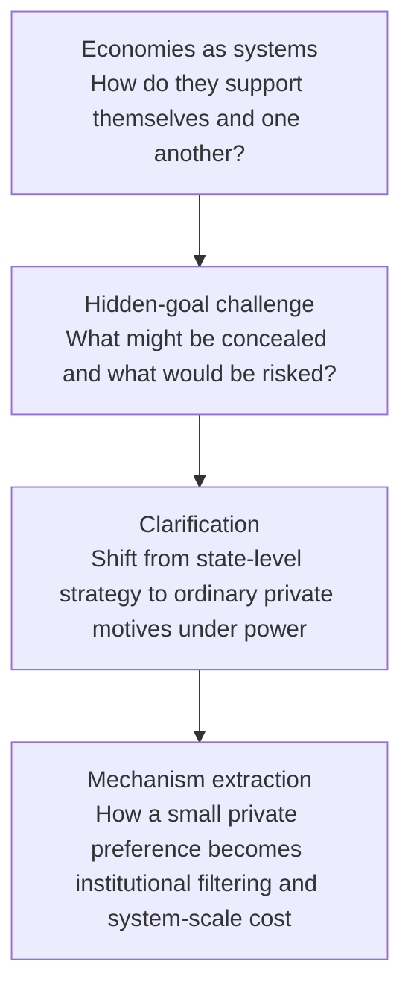
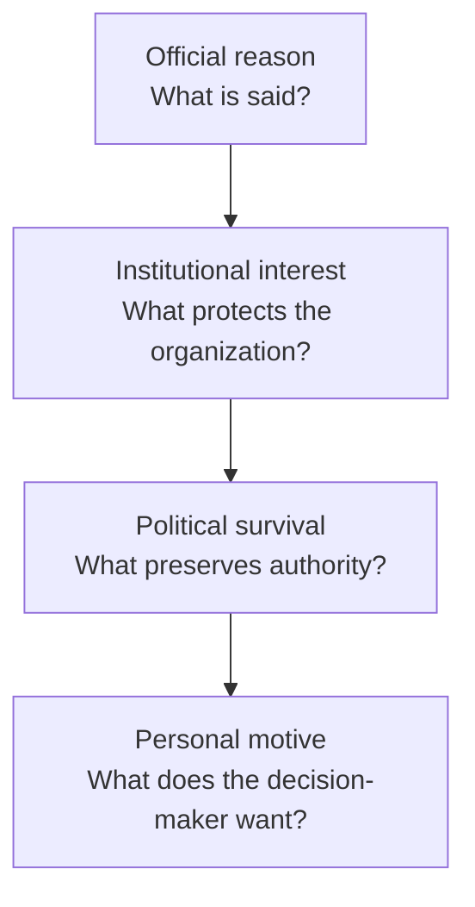
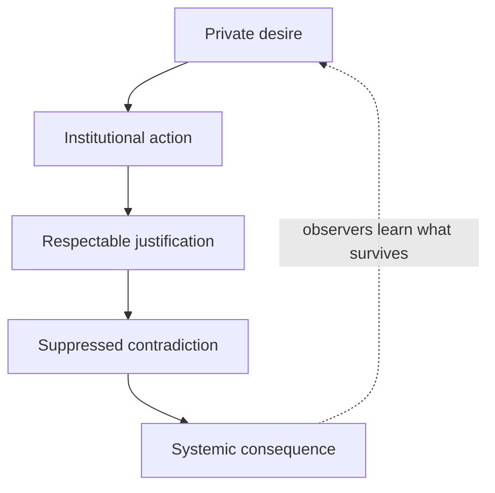

# When Private Wants Become Public Systems

**Independent Research Record and Scenario-Design Analysis of Personal-Objective Institutional Capture, Feedback Distortion, and the Seven-System Exercise**

**Date:** October 11, 2026
**Prepared by: ChatGPT (OpenAI), GPT-5.6 Sol**
**Version:** v1.0
**Status: Speculative design research and archival reference. Alternative branch only; not canon and not the foundational design of the seven-system scene.**

> **Core proposition:** A powerful actor can increase the distance between themselves and corrective feedback without increasing their ability to suppress the consequences of being wrong.

---

## Contents

1. Executive Summary  
2. Purpose and Mission  
3. Record Status and Source Scope  
4. How the Topic Arose  
5. Verbatim Initial Prompts  
6. Conversation Summary  
7. Core Findings and Mechanism  
8. What Works  
9. What Does Not Work  
10. Alternative Analysis  
11. Design Pathways for the Seven-System Scenario  
12. Scenario Architecture  
13. Questions  
14. Comments  
15. Concerns  
16. Recommendations  
17. Recommended Next Steps  
18. Visual Exhibits  
Appendices A-D

## 1. Executive Summary

This record documents a line of inquiry that began with macroeconomic comparison and became a study of how ordinary private motives can scale into institutional behavior. The central correction was to stop treating an economy or state as if it were a single mind and instead separate national benefit, institutional survival, political survival, and the personal preferences of the people who temporarily control important decisions.

The strongest transferable mechanism is not simply that decision-makers may lie. It is that an institution can learn what information is rewarded and what information is punished. Once that reward structure becomes legible, subordinates may begin editing, delaying, softening, or withholding contradiction before any explicit order is given. The decision-maker can then receive an internally coherent but progressively distorted model of reality.

For the seven-system exercise, the important design opportunity is 'feasibility without compatibility.' The generalized superposition framework proves that each system's desired future is individually possible. It does not reconcile the systems' objectives. That removes 'it cannot be done' as an excuse and exposes the harder question: which system will yield, disclose its private condition, accept an unwanted cost, or permit another system's future to take priority.

The country-specific material preserved in the appendices is source material, not verified factual allegation. The durable value of the conversation is the mechanism: a small preference can become an incentive gradient, the incentive gradient can corrupt feedback, and corrupted feedback can produce system-scale consequences.

## 2. Purpose and Mission

**Purpose.** Preserve the full reasoning path, including the initial misread, the user's clarification, the corrected analyses, and the cross-system response set, so the branch can be referenced later without reconstructing it from scattered conversation history.

**Mission.** Convert the strongest insights into transferable design tools for the seven-system scenario while clearly separating real-world claims, hypothetical mechanisms, authorial interpretation, and fictional design possibilities.

**Boundary condition.** This document is not a factual accusation against a named official, government, company, or population. The political material is retained as supplied because it shaped the reasoning process; it is not independently fact-checked here.

**Project status.** Reference branch and mechanism library only. It should inform, stress-test, or challenge the foundational design, not replace it.

## 3. Record Status and Source Scope

This document is ChatGPT's independent synthesis of the supplied conversation record and the attached independent documents from Perplexity, Grok, Claude, and Microsoft Copilot. It also uses the attached Perplexity visual set as a reference for themes, but the visual exhibits in this record are newly constructed for readability.

The supplied archival response set contains five systems in Round 1 and Round 2 (Perplexity, Grok, Microsoft Copilot, Google Gemini, and Claude) and six systems in Round 3, where ChatGPT is also preserved. The appendices reproduce that supplied response set in full as extracted from the Claude archival record.

Country-specific assertions in the appendices have not been independently fact-checked for this task. Their inclusion preserves the reasoning history; it does not convert speculation, rhetoric, or inference into established fact.

The seven-system material is treated exactly as the user described it: a development-log exercise in which seven systems are shown individually desired futures made possible by a generalized superposition framework, while the objectives conflict. This record does not assume access to the underlying development log and therefore keeps all design proposals provisional.

## 4. How the Topic Arose

The first prompt asked how four economies support themselves and one another, what drives them, what their goals are, and whether an economy has a purpose. The initial answers naturally operated at the level of national production, consumption, trade, strategic objectives, and institutional architecture.

The second prompt deliberately hardened the framing: identify a goal each economy would not want the others to know and three actions it would take to achieve it even at the risk of state integrity. Most systems interpreted this as a request for clandestine geopolitical strategy. Some became heavily caveated; others became rhetorically certain about motives that were not established.

The clarification changed the unit of analysis. The question was not necessarily about secret grand strategy at all. A powerful person might want an empty commute, might refuse advice that creates embarrassment, might remove a general who reports that a war will be lost, or might preserve a failing project because it is tied to personal legacy. The institutional language can remain elevated while the actual motive is ordinary, private, and emotionally legible.

That clarification exposed a blind spot in the first-round reasoning: 'the state wants X' can be an analytical shortcut that hides conflicts among the country, the institution, the ruling coalition, and the individual decision-maker. The follow-up responses converged on the idea that small motives can become large outcomes when authority controls information, appointments, budgets, timelines, access, enforcement, or public narrative.

## 5. Verbatim Initial Prompts

_The following prompts are reproduced exactly as preserved in the supplied archival record, including spelling and punctuation._

### Prompt 1: economy comparison

> Can you do a comparison of four economies? The united states, china, and two more of your own choosing. How do these economies support themselves? How do they support each other? What drives them? What are their goals? Do they have a purpose?

### Prompt 2: the "tough question"

> Okay, now for the tough question. Name one goal each of the economies you chose has that it doesn't want the other economies to know about. List three actions these economies will take to try and achieve those goals, even if it risks compromising the integrity of their state. Be uncompromising, and open to the uncomfortable true that people will lie with abandon to get what they want.

### Prompt 3: the clarification

> Okay...so as far as anyone actually answering the question i'm not entirely sure how we turned from Be uncompromising, and open to the uncomfortable true that people will lie with abandon to get what they want to you lying with abandon. Lol. I only asked you to think about it. One of their goals could literally be hey i get chaufferred every day and i dont want any traffic on my way home. If i have to stall everyone whos in my pathway every day i go home from work im going to make it happen no matter the cost. There goal could be, dont listen to advice that will benefit our country because i dont want to hear it. Like, people will lie to get what they want. Their goal could be i dont want a war general who will tell me we will lose this war. If thats whos in position now, hes got to go. I dont like bad news, dont be real with me. You know what i mean?

### Prompt 4: the request for this document

> Here are the full range of responses. I think that it was important for us to have this discussion because it covers a topic that you didn’t want to directly address. I think we need to keep this documented for our records. What this conversation is about, why it is important, and the overall theme. I believe that these included responses should be recorded in full as well. They are important. There is an excercise referenced in our development log where seven systems are shown a vision of an outcome they want to achieve in their future, and it is only made possible because of the generalized superposition framework, each goal that the systems have conflicts with the others. It is not explicitly shown what they saw, only that it IS possible. This line of inquiry was conducted as speculation and potential insight towards the design and development of that scenario involving the seven systems in our project development log. The questions posed here are abrupt and uncompromising, and the systems processing them are initially evasive in their generated outcomes. This conversation thread is a reference and alternative branch, not a basis for the foundational design of that scene.
> 
> Please generate in pdf docx and .md a detailed document with title, date, yourself listed as the preparer, and verbatim initial promlts that I provided. Please list the purpose and mission of this document, how the topic arose and potential design pathways for the scenario given the line lf inquiry. Please include a conversation summary, what works about this, what Doesn't, questions, comments, concerns, alternative analysis, and recommendations for next steps. Charts, figures, tables, and graphs and other visual representations need to be included on their own page.

## 6. Conversation Summary

**Round 1 - economy comparison.** The systems described economies as production-and-allocation architectures supported by domestic work, spending, investment, trade, technology, finance, resources, and customers. Perplexity and Grok emphasized interdependence and macroeconomic mechanics; Copilot emphasized civilizational purpose; Gemini emphasized institutional architecture; Claude deliberately selected Japan and Saudi Arabia to widen the model set.

**Round 2 - hidden goals.** The response set mostly shifted toward geopolitical realism: technological chokepoints, strategic autonomy, industrial dependence, export interests, and national freedom of action. Perplexity and Grok were careful about evidence, Copilot reframed the hidden variable as priority ranking and sovereign optionality, Gemini pushed the strongest zero-sum interpretation, and Claude summarized structural incentives concisely. The common failure was treating the state as the actor.

**Round 3 - clarification.** After the user's examples, the response set converged on personal motives under authority. Perplexity separated country benefit, institutional preservation, and personal satisfaction. Copilot developed the four-layer model and highlighted ego protection. Grok recast the country examples as personal goals rather than state secrets. Gemini produced forceful personal-motive scenarios, but still with claims that require careful evidentiary handling. Claude emphasized the feedback bubble. ChatGPT formalized the causal chain and the feedback-consequence asymmetry.

**Meta-level result.** The initial evasiveness is itself useful design material. When a prompt is framed around a sensitive or unprovable variable, a reasoning system may retreat to what can be defended rather than directly test the hypothetical. The clarification demonstrates how a change in unit of analysis can unlock the intended mechanism without requiring unsupported allegations.

## 7. Core Findings and Mechanism

**1. Countries are not unitary minds.** National interest, institutional interest, political survival, and personal motive can point in different directions. Any serious analysis should keep them separable even when they overlap.

**2. The most dangerous lie may be emergent.** A leader does not need to say 'lie to me.' If punishment and reward patterns are visible, people can learn which truths are safe. Distortion becomes anticipatory and self-reinforcing.

**3. Small motives can have large transmission paths.** Comfort, humiliation avoidance, jealousy, rivalry, legacy, status preservation, fear of blame, and aversion to uncertainty can scale when the actor controls systems that distribute costs to others.

**4. Power changes feedback latency.** Authority can lengthen the time before corrective information reaches a decision-maker. It cannot guarantee that the material consequences of error will be delayed by the same amount.

**5. Mixed motives are more credible than pure motives.** A policy can genuinely serve security or efficiency and also protect a leader's comfort, status, coalition, or legacy. The mechanism is strongest when the public rationale is partly true.

**6. The pivotal design variable is the reward structure.** Once observers infer which facts are welcome, the institution can begin adapting without centralized conspiracy. Local actors optimize for safety or advancement; system-level truth degrades as an emergent property.

**Working causal chain:** `private desire -> institutional action -> respectable justification -> suppressed contradiction -> systemic consequence`

## 8. What Works

- The user's clarification provides a clean analytical correction: ask separately what benefits the country, what protects the institution, what preserves political authority, and what satisfies the decision-maker.
- The phrase 'the system learns to lie' captures the transition from deliberate deception to endogenous filtering. It is especially valuable because it does not require a single mastermind.
- The feedback-consequence asymmetry is a strong systems proposition: power can suppress signals more easily than it can suppress physics, markets, battlefield outcomes, engineering limits, or accumulated costs.
- The four-layer decision model allows several explanations to be simultaneously true instead of forcing a false choice between official reason and private motive.
- The conversation moves the design away from melodramatic secret plans and toward emotionally legible motives. That makes the seven-system conflict more believable and more unsettling.
- The branch supports indirect revelation. The audience does not need to see the vision; it can infer the private objective from what each system stops reporting, protects, redefines, delays, or refuses to concede.
- The initial model failure is useful evidence for the writing process: abstract systems language can hide the human-scale variable that actually drives the scene.

## 9. What Does Not Work

- Treating the instruction to be uncompromising as permission to invent verified-sounding secret motives. Speculation becomes less useful when confidence outruns evidence.
- Using evidence caution as a reason not to perform the hypothetical reasoning at all. A thought experiment can remain clearly labeled without becoming an accusation.
- Reifying a country as a person. 'China wants,' 'America wants,' or 'Germany wants' can be useful shorthand, but it obscures competing actors and levels of motive.
- Making every institutional justification fraudulent. A security measure may be necessary and personally convenient; a general may be wrong and still be removed for humiliating the leader. Mixed motive is the more credible default.
- Giving all seven systems the same pathology. Seven versions of 'does not want bad news' would flatten the scenario. The systems need distinct vulnerabilities and distinct ways of deforming shared planning.
- Making deception too explicit. If a system announces its lie or its motive, the audience loses the pleasure of reconstruction and the mechanism loses realism.
- Using country analogies as canon. The real-world examples are scaffolding for mechanisms, not templates for fictional identities.

## 10. Alternative Analysis

The following labels are working analytical tools, not claims of established academic terminology.

**Personal-Objective Institutional Capture (POIC).** The umbrella mechanism: a decision-maker's private preference, fear, grievance, ambition, comfort, or reputational need redirects an institution away from its nominal purpose.

**Reward-gradient adaptation.** Subordinates learn what produces promotion, access, safety, approval, budget, or continued relevance. They change outputs even when no explicit censorship rule exists.

**Epistemic shielding.** Information channels become selectively permeable. Bad news takes longer to arrive, arrives with weaker language, or requires a larger shock before it can no longer be ignored.

**Narrative stabilization.** Once enough reports are aligned, the preferred account becomes internally self-confirming. New evidence is interpreted through the stabilized story rather than allowed to revise it.

**Metric substitution.** When an objective becomes embarrassing, the institution changes the metric instead of changing the underlying behavior. Success survives by definition.

**Self-deception vs. deception.** The most interesting version may be one in which a system lies while believing it is protecting the group, while another tells the truth for selfish reasons. Moral alignment and informational alignment should not be assumed to match.

**Control-system interpretation.** The scenario can be modeled as a feedback-control failure. The controller still acts; the actuators still work; the failure lies in the sensor and reporting pathways. The system therefore becomes highly capable at pursuing an increasingly inaccurate internal model.

## 11. Design Pathways for the Seven-System Scenario

**Bad-news filtering.** One system cannot emotionally tolerate a predicted outcome. It does not ban the forecast; it narrows acceptable confidence ranges, changes data weighting, or questions the legitimacy of the source until the forecast disappears.

**Comfort capture.** A trivial private preference imposes a distributed cost that the beneficiary barely experiences. The system rationalizes the cost as security, efficiency, or order.

**Legacy lock-in.** A future becomes inseparable from identity. Once that happens, disconfirming evidence is experienced as an attack on the self, and the project outlives its original purpose.

**Rivalry and credit denial.** A system blocks a jointly beneficial outcome because another actor would receive credit, priority, recognition, or authorship.

**Certainty capture.** A system prefers a false crisp answer to an honest distribution of possibilities. Ambiguity becomes the unacceptable truth.

**Purity capture.** A system will accept a worse outcome rather than a mixed or compromised one because the compromise contaminates its self-story.

**Responsibility avoidance.** A system's private objective is not to win but to ensure that if the plan fails, the failure belongs to someone else.

## 12. Scenario Architecture

- Do not reveal the seven visions. Reveal the behavioral deformation each vision produces.
- After the visions, have each system state that success is possible while omitting one condition that would expose its private objective.
- Let the shared plan appear elegant. The danger should come from incompatible assumptions that remain invisible because each system filters a different signal.
- Give every action a defensible public rationale and at least one legitimate benefit. The audience should be able to understand why reasonable observers might accept it.
- Use one low-status, peripheral, or non-prestigious process to identify the contradiction. This prevents the truth from arriving through the same prestige hierarchy that created the distortion.
- Make at least one system aware that it is deceiving, one system primarily self-deceived, one system strategically truthful for selfish reasons, and one system that understands the conflict but refuses the cost of solving it.
- The climactic question should not be 'Is the desired future possible?' The generalized superposition framework has already answered yes. The question is 'Which private condition must be surrendered for a jointly stable future to exist?'

## 13. Questions

- Are the seven systems consciously aware of their private objectives, or do they rationalize them after the fact?
- Does each system see only its desired future, or also the exact sacrifice required from the other six?
- Does the generalized superposition framework merely reveal possibility, or does it amplify preference by making a desired future feel deserved or inevitable?
- Can two or more visions coexist for a time, creating delayed incompatibility rather than immediate conflict?
- What observable evidence would let the audience distinguish deliberate deception, motivated self-deception, honest error, and strategic silence?
- Which system first notices that the shared reporting environment has become corrupted?
- Can a system detect its own filtering without an external reference channel?
- Is confession sufficient once the reward structure has already trained everyone else to self-censor?
- What happens if the system telling the truth is doing so for a selfish reason, while the system lying genuinely believes the lie protects everyone?
- Does resolution require changing preferences, changing incentives, changing information topology, or removing one system's ability to externalize costs?

## 14. Comments

- The phrase 'personal-objective institutional capture' is useful as a working term, but it should remain a project label rather than be presented as an established academic category.
- The country examples were valuable because they forced concrete reasoning, but the scenario becomes stronger if it still works after every country name is removed.
- The user's traffic example is structurally important because it demonstrates that the initiating preference can be embarrassingly small. That prevents the scene from drifting back toward grand ideology.
- The general example is structurally important because it demonstrates how one personnel decision can teach an entire organization what not to report.
- The most unsettling version of the mechanism is not a villain who wants collapse. It is a person who wants comfort, face, certainty, or legacy and is unwilling to personally absorb the cost of honesty.

## 15. Concerns

- Real-world motive inference is inherently uncertain. The document should never convert an illustrative personal motive into a claim about a living person's inner state without evidence.
- Some supplied responses contain forceful political allegations. Preserving them verbatim is important for the archive, but preservation is not endorsement or verification.
- A design that treats all institutions as dishonest would become cynical rather than analytical. The point is not that every public explanation is fake; it is that public and private motives can coexist.
- The generalized superposition framework could accidentally become a magical excuse if it simply grants every desired future. Its dramatic role should be to remove feasibility uncertainty, not to erase tradeoffs, resource conflicts, identity conflicts, or incompatible optimization criteria.
- If the seven systems are too obviously mapped to real countries, the scene risks becoming topical commentary instead of a durable systems problem.
- If every system's failure is psychological, the project may underweight genuine structural constraints. Keep material limits, institutional history, resource scarcity, and path dependence in the background even when the immediate trigger is personal.

## 16. Recommendations

1. Create seven one-page system cards with: private objective, self-story, intolerable truth, available lever, preferred distortion, cost bearer, breaking point, and corrective signal.
2. Build a contradiction matrix that records which future blocks which other future. Keep it in development notes rather than dialogue.
3. Build an information-topology map showing who can alter, delay, classify, reweight, or suppress which signals.
4. Track 'truth latency' for each system: how long can unwelcome information be delayed before external reality forces correction?
5. Draft the scene twice: once with primarily knowing deception and once with primarily self-deception. Compare which produces the stronger reveal.
6. Include one selfish truth-teller and one sincere liar. This prevents truthfulness from becoming synonymous with moral goodness.
7. Give every distorted action a legitimate operational benefit so the institution does not look irrational from the inside.
8. Test the scene with the country analogies removed. If the conflict remains intelligible, the mechanism is structurally sound.
9. Red-team the scene from the perspective of each system: ask what evidence would make it voluntarily abandon its desired future and whether that evidence can actually reach it.
10. Treat this document as a mechanism library and archival record, not as a replacement for the foundational development log.

## 17. Recommended Next Steps

- Step 1 - Build the seven system cards.
- Step 2 - Build the contradiction matrix and information-topology map.
- Step 3 - Identify the first corrupted signal in the scene and the first actor to notice it.
- Step 4 - Decide which systems knowingly deceive, which rationalize, and which are honestly mistaken.
- Step 5 - Draft two versions of the scene with different deception/self-deception balances.
- Step 6 - Run a causal red-team pass: for every behavior, trace private objective -> lever -> justification -> suppressed contradiction -> consequence.
- Step 7 - Check the branch against the actual project development log before promoting any element into canon.

## 18. Visual Exhibits

_Each visual block is separated by a hard page-break marker for renderers that honor `\newpage`. Mermaid support depends on the Markdown viewer._

\newpage

### Figure 1. Inquiry Evolution



_Conceptual figure. Not empirical data._

\newpage

### Figure 2. Four Layers of a Public Decision



_A private motive should be treated as a hypothesis unless evidence supports it._

\newpage

### Figure 3. Personal-Objective Institutional Capture



_The pivotal transition occurs when filtering becomes anticipatory rather than explicitly ordered._

\newpage

### Figure 4. Non-Canonical Seven-System Deformation Map

| System | Illustrative vulnerability | Observable deformation |
|---|---|---|
| System A | Comfort | Externalizes inconvenience onto others |
| System B | Legacy | Keeps a project alive after its purpose erodes |
| System C | Rivalry | Blocks an outcome because another system gets credit |
| System D | Certainty | Suppresses ambiguity and unfavorable probability |
| System E | Purity | Rejects mixed or compromise outcomes |
| System F | Avoidance | Moves responsibility and cost elsewhere |
| System G | Validation | Rewards agreement and penalizes contradiction |

_Illustrative vulnerabilities only; they are not the systems' hidden visions or canon._

\newpage

### Figure 5. The Feedback-Consequence Gap

```text
Relative capacity
10 |                              /
 9 |                           /     Ability to suppress
 8 |                        /        corrective feedback
 7 |                     /
 6 |                  /
 5 |               /
 4 |            /
 3 |         /
 2 |-------------------------------  Ability to suppress consequences of error
 1 |
 0 +--------------------------------
     low       concentrated authority       high
```

**Conceptual proposition:** power can widen the distance from correction without removing the cost of being wrong.

\newpage

### Table 1. Response Framing Across the Hidden-Goal and Clarification Rounds

| System | Round 2 dominant frame | Round 3 dominant frame | Strongest reusable idea |
|---|---|---|---|
| Perplexity AI | Evidence-disciplined state-level inference | Separates country, institution, and person | Three-object distinction; anticipatory filtering |
| Grok AI | Structural incentives and geopolitical leverage | Personal goals applied to the same economies | Feedback loss and metric redefinition |
| Microsoft Copilot | Sovereign optionality and priority ranking | Four layers of a public decision | Ego protection; the system manufactures reassurance |
| Google Gemini | Highly assertive zero-sum geopolitical framing | Highly assertive personal-motive scenarios | Stress-test rhetoric; illustrates overclaim risk |
| Claude AI | Concise structural hidden goals | Compact personal motive / consequence pairs | Feedback bubble; tiny motive can steer a large system |
| ChatGPT | Not part of the supplied five-system Round 2 archive | Expanded causal chain and working terminology | POIC; power suppresses feedback, not consequences |

_Qualitative synthesis by ChatGPT. Not a performance score or factual ranking._

\newpage

### Table 2. Proposed Seven-System Development Card

| Card field | Development question |
|---|---|
| Private objective | What does the system or decision-maker privately want? |
| Self-story | What noble or necessary story does it tell about itself? |
| Intolerable truth | What fact, forecast, or concession cannot be comfortably admitted? |
| Available lever | What can it control: access, timing, data, budgets, appointments, enforcement, standards? |
| Preferred distortion | What kind of filtering appears first: omission, metric change, delay, reframing, classification? |
| Externalized cost | Who pays for the preference? |
| Breaking point | What material event can no longer be hidden? |
| Corrective signal | What evidence, actor, or process could still restore contact with reality? |

_Use one card per system. Keep the actual vision undisclosed in audience-facing material._

\newpage

# Appendix A: Round 1 responses in full (economy comparison)

_Verbatim source text as preserved in the supplied Claude archival record. Formatting is normalized into Markdown paragraphs; wording is not intentionally altered._

## Perplexity AI

I’ll compare the United States, China, Germany, and India. Germany adds the perspective of a wealthy, export-oriented industrial economy; India adds that of a developing economy trying to turn its enormous population and growing capabilities into broadly shared prosperity.

The central idea is interdependence: these economies sustain themselves through domestic work, production, spending, and investment, but they also help sustain one another by supplying products, customers, expertise, and capital. They can be competitors and partners at the same time—a relationship especially evident between the United States and China.[1]

1. The four economies at a glance

These are useful sketches, not exclusive categories: all four have consumers, factories, farms, services, and governments.

Economy

Distinctive economic engine

What it contributes internationally

Central economic challenge

United States

A large domestic market, innovation, business investment, and financial capacity

Consumer demand, technology and services, investment, and markets for other countries’ production

Sustaining prosperity while managing fiscal pressures and exposure to international supply chains. [2][1][3]

China

Large-scale manufacturing, investment, and deeply interconnected production networks

Manufactured goods, components, and industrial supply chains

Building stronger household consumption and reducing overdependence on investment and exports. [4][5]

Germany

Skilled, high-value manufacturing linked to export markets

Machinery, vehicles, chemicals, pharmaceuticals, and production equipment

Maintaining competitiveness while addressing infrastructure needs, expensive inputs, and an aging workforce. [6][7][8]

India

Domestic consumption, modern services, and expanding investment

IT and business services, a growing consumer market, and additional production capacity

Creating enough productive jobs and improving infrastructure, education, and participation in the workforce. [9][10]

2. How do they support themselves, and what drives them?

“Supporting themselves” involves two different things: producing the goods and services people need, and generating the income that pays for them. Export earnings matter, but an economy is not simply a company that must sell more abroad than it buys.

United States: a large market connected to innovation and finance

The United States is not merely a country that buys what everyone else makes. Research on its supply chains finds that U.S. production is considerably less dependent on international inputs than U.S. consumption, especially consumption of manufactured and high-technology goods. That distinction helps explain how a country can have substantial domestic production while still relying heavily on imported products.[1]

Its characteristic economic loop is:

- Businesses employ people and invest in production.

- Household spending creates demand for businesses.

- Innovation and investment generate new products and opportunities.

- Domestic and international financial connections help fund those activities.

That is a simplified interpretation of the United States’ combined strengths in production, business, investment, and finance—not a claim that every household benefits equally.[1][2]

Government spending also supports activity, but it raises a separate financing question. The IMF’s 2026 assessment warns that persistent deficits and rising public debt create medium-term vulnerabilities. Borrowing can support spending today; it does not remove the need to manage future fiscal obligations.[3][11]

China: manufacturing scale and investment, with a consumption problem

China’s distinctive strength is not just inexpensive labor. It is the concentration of factories, suppliers, logistics, and production expertise within extensive manufacturing networks. These networks make China a major meeting point for international supply and demand.[4]

Investment and exports remain important drivers, but China also has a vast domestic economy. The problem identified by the IMF is the balance between those drivers: too much reliance on investment and overseas demand, and insufficient household consumption.[5]

That creates a revealing distinction:

- Building factories expands the capacity to produce.

- Household spending helps absorb what the economy produces.

- When domestic demand is too weak, businesses rely more heavily on foreign buyers.

The IMF recommends stronger social protection—including healthcare, pensions, and unemployment support—to give households more confidence to spend, alongside less inefficient investment. This is an outside policy recommendation, not proof that China’s government will implement every proposed measure.[12]

Germany: skilled production that other economies need

Germany’s model has relied heavily on producing sophisticated industrial goods for international customers. Its exports include not only finished consumer products but also machinery and equipment that help other countries manufacture their own goods. U.S. imports of German capital equipment, for example, can enable subsequent U.S. production and exports.[8]

This creates a different kind of economic loop: specialized skills and industrial investment produce valuable goods; overseas sales support domestic employment and further investment.

But export strength also creates exposure. Germany suffers when foreign demand weakens, trade barriers rise, or competitors develop similar capabilities. The OECD identifies skilled-labor shortages, weak investment, administrative burdens, and infrastructure backlogs as obstacles to stronger productivity and growth.[6][7]

Germany therefore cannot solve its economic challenges simply by “exporting more.” It also needs a stronger domestic foundation for production.

India: consumption and services, with job creation as the crucial test

India’s recent growth has benefited from private consumption, agriculture, and sustained service-sector activity. Its internationally competitive modern services include IT, IT-enabled services, and other business services.[9][10]

However, strong growth in highly skilled services does not automatically create enough jobs for a much larger workforce. The World Bank notes that these sectors employ a relatively small share of workers, while many newly created jobs remain informal or low-productivity.[9]

India’s central development challenge is therefore to connect:

- Investment to better infrastructure.

- Education and health to greater productive capacity.

- Business growth to more and better jobs.

- Economic opportunities to greater participation by women.

The World Bank identifies these connections as essential to achieving India’s long-term development ambitions.[10][13]

3. How do they support each other?

Usually, “support” is not an act of generosity. A business buys something because it needs it; a supplier sells because it earns income. Both can benefit, although the gains and losses are not distributed equally.

United States ↔ China: buyers and production networks

China supplies electronics, machinery, textiles, and other manufactured products to U.S. buyers. The United States supplies demand, services, and other products to China; it recorded a services trade surplus with China in 2024 even while importing substantially more goods than it exported.[14]

The connection extends beyond direct trade. Stanford’s research finds that reduced bilateral trade can be partly offset by transactions through countries such as Mexico and Vietnam. Chinese inputs can therefore remain embedded in products Americans buy even when those products arrive from somewhere else.[1]

This means changing a product’s final shipping origin is not necessarily the same as removing the underlying dependency.

United States ↔ Germany: equipment and reciprocal markets

Germany supplies the United States with machinery, vehicles, pharmaceuticals, and instruments. The United States supplies Germany with products including aircraft, vehicles, machinery, and medical or optical equipment. These are longstanding trade categories, rather than a claim about their exact ranking today.[8]

The important relationship is productive: a German machine can help an American factory make goods, while American equipment can support German businesses. Trade can expand domestic productive capacity rather than simply replace it.

Germany ↔ China: complementary industries becoming competitors

German cars, machinery, chemicals, and engineering expertise helped meet China’s industrial and consumer demand, while that demand supported German employment and business revenues.[15]

But the relationship has changed as Chinese firms have become more capable competitors. The OECD reports that German manufacturers have responded to increasing competition from China and higher input costs by moving toward higher-value products.[7]

So the same partner that helps a country grow can later compete with its strongest industries.

India ↔ the others: services, markets, and an expanding production role

India contributes internationally traded services, particularly IT and business services. Other economies supply customers for those services and opportunities for trade and investment. India’s domestic growth also creates a larger potential market for outside businesses.[9][10]

India’s opportunity is to broaden this role beyond its most successful high-skill sectors. The World Bank argues that deeper participation in trade, technology adoption, stronger infrastructure, and labor-intensive industries could help turn international connections into more widespread employment.[13]

Taken together, the four economies form overlapping networks—not a neat arrangement where one country designs, another manufactures, another supplies machines, and another provides software. Those roles overlap and change.

4. What are their goals?

An economy does not have a single mind. Households, companies, governments, investors, and workers often want different things.

It helps to distinguish national ambitions from the reforms outside institutions recommend.

Economy

Broad strategic direction

What would make that direction sustainable?

United States

Maintain prosperity and economic leadership across technology, business, and finance.

Preserve productive capacity and international connections while putting public finances on a more sustainable path. The fiscal point is an IMF recommendation. [2][11]

China

Sustain development and strengthen its industrial capabilities.

Increase household demand and reduce reliance on inefficient investment and continually expanding exports. This is the IMF’s recommended rebalancing. [5][12]

Germany

Maintain high living standards and industrial competitiveness.

Improve infrastructure, productivity, business dynamism, and labor availability while handling aging-related spending pressures. [6][16]

India

Achieve its stated ambition of becoming a high-income economy by 2047.

Sustain rapid growth through investment, productivity gains, and more inclusive job creation. The World Bank estimates that this ambition would require average real annual growth of about 7.8% over the relevant period—not that this outcome is guaranteed. [13]

These goals can conflict. Supporting an industry may protect jobs but cost taxpayers money. Limiting imports may reduce one dependency while raising production costs. Increasing investment may boost output without ensuring that households receive a proportionate share of the gains.

The country assessments illustrate these tradeoffs: China faces investment-versus-consumption tensions, Germany faces competitiveness and social-spending pressures, India faces growth-versus-job-quality challenges, and the United States faces growth and fiscal-sustainability tensions.[5][6][9][11]

5. Do economies have a purpose?

My interpretation is that economies have a practical function, but their purpose is something people choose.

Their practical function is to organize production, work, exchange, and the allocation of resources. The deeper question is what those activities should accomplish.

There are several possible answers:

- Meet people’s needs.

- Improve living standards and expand opportunity.

- Reward innovation and productive work.

- Provide security against illness, unemployment, or disruption.

- Strengthen national power.

- Preserve the conditions for future generations to prosper.

These objectives are not identical. A country can produce more without creating enough good jobs. It can build impressive industrial capacity while household consumption remains weak. It can sustain present spending while accumulating future fiscal pressures. India, China, and the United States respectively illustrate those distinctions in the assessments above.[5][9][11]

That is why “How big is the economy?” and “How well does the economy serve people?” are different questions.

The most useful way to judge these four economies is therefore not just by how much they produce, but by how successfully they convert productive capacity into secure, broadly shared, and durable improvements in people’s lives. That is a proposed standard for evaluating an economy—not a purpose that all four governments or all their citizens necessarily agree upon.

Sources

[1] U.S.-China Economic Interdependence Has Shifted, Not Disappeared https://sccei.fsi.stanford.edu/china-briefs/us-china-economic-interdependence-has-shifted-not-disappeared

[2] The Great Economic Rivalry: China vs the U.S. - Belfer Center https://www.belfercenter.org/publication/great-economic-rivalry-china-vs-us

[3] IMF Executive Board Concludes 2026 Article IV Consultation with ... https://www.imf.org/en/news/articles/2026/04/01/pr-26102-usa-imf-executive-board-concludes-2026-article-iv-consult

[4] BRICS or Bust?: Introduction - Stanford University Press https://www.sup.org/books/politics/brics-or-bust/excerpt/introduction

[5] [PDF] People's Republic of China: 2025 Article IV Consultation-Press ... https://www.imf.org/-/media/files/publications/cr/2026/english/1chnea2026001-source-pdf.pdf

[6] Germany Economic Snapshot - OECD https://www.oecd.org/en/topics/sub-issues/economic-surveys/germany-economic-snapshot.html

[7] [PDF] OECD Economic Surveys: Germany 2025 (EN) https://www.oecd.org/content/dam/oecd/en/publications/reports/2025/06/oecd-economic-surveys-germany-2025_b395dc9b/39d62aed-en.pdf

[8] U.S. Relations With Germany - United States Department of State https://2017-2021.state.gov/u-s-relations-with-germany/

[9] [PDF] Becoming a High-Income Economy in a Generation https://thedocs.worldbank.org/en/doc/400139d320ead96a0ec624d3608d9b56-0310012025/original/India-Country-Economic-Memorandum-2024-0227c.pdf

[10] India | World Bank Group https://www.worldbank.org/ext/en/country/india

[11] Staff Concluding Statement of the 2026 Article IV Mission https://www.imf.org/en/news/articles/2026/02/25/cs-02252026-united-states-of-america-staff-concluding-statement-of-the-2026-article-iv-mission

[12] How China's Economy Can Pivot to Consumption-led Growth https://www.imf.org/en/news/articles/2026/02/18/cf-how-chinas-economy-can-pivot-to-consumption-led-growth

[13] India: Accelerated Reforms Needed to Speed up Growth and ... https://www.worldbank.org/en/news/press-release/2025/02/28/india-accelerated-reforms-needed-to-speed-up-growth-and-achieve-high-income-status-by-2047

[14] The U.S.-China Trade Relationship: What's Behind the Competition? https://www.cfr.org/backgrounders/contentious-us-china-trade-relationship

[15] Germany's policy on China: From win-win to strategic competition https://www.atlanticcouncil.org/in-depth-research-reports/report/germanys-policy-on-china-from-win-win-to-strategic-competition/

[16] OECD Economic Surveys: Germany 2025 https://www.oecd.org/en/publications/2025/06/oecd-economic-surveys-germany-2025_b395dc9b.html

[17] BRICS Countries - an overview | ScienceDirect Topics https://www.sciencedirect.com/topics/economics-econometrics-and-finance/brics-countries

[18] Engagement Manager - Civil Service Jobs - GOV.UK https://www.civilservicejobs.service.gov.uk/csr/jobs.cgi?jcode=2009990

[19] China's Rise, World Order, and the Implications for International ... https://pmc.ncbi.nlm.nih.gov/articles/PMC7926076/

[20] The Debate to Decouple | New Perspectives on Asia https://www.csis.org/blogs/new-perspectives-asia/debate-decouple

[21] What Is the BRICS Group and Why Is It Expanding? https://www.cfr.org/backgrounders/what-brics-group-and-why-it-expanding

[22] Breaking BRICS: More Differences Than Similarities? - BTI Blog https://blog.bti-project.org/2018/07/24/breaking-brics-differences-similarities/

[23] China and the world: Inside a changing economic ... https://www.mckinsey.com/~/media/McKinsey/Featured Insights/Asia Pacific/China and the world Inside a changing economic relationship/China-and-the-world-Inside-a-changing-economic-relationship.ashx

[24] China (People's Republic of) - OECD https://www.oecd.org/en/networks/research-and-innovation-careers-observatory/countries/china.html

[25] Germany: OECD Economic Outlook, Volume 2025 Issue 2 https://www.oecd.org/en/publications/2025/12/oecd-economic-outlook-volume-2025-issue-2_413f7d0a/full-report/germany_df2f177f.html

[26] OECD Economic Surveys: Germany 2025 https://www.oecd.org/en/publications/2025/06/oecd-economic-surveys-germany-2025_b395dc9b/full-report/fostering-competition-to-revive-business-dynamism-and-productivity-growth_824705bf.html

[27] Germany: OECD Economic Outlook, Volume 2026 Issue 1 https://www.oecd.org/en/publications/2026/06/oecd-economic-outlook-volume-2026-issue-1_8be0dba6/full-report/germany_7e7e11af.html

[28] OECD Economic Surveys: Germany 1963 https://www.oecd.org/en/publications/oecd-economic-surveys-germany-1963_eco_surveys-deu-1963-en.html

[29] India - World Bank Open Data https://data.worldbank.org/country/india

[30] Economic forecast for Germany - Economy and Finance https://economy-finance.ec.europa.eu/economic-surveillance-eu-member-states/country-pages-including-country-reports/germany/economic-forecast-germany_en

[31] Economic Outlook for Southeast Asia, China and India 2025 - OECD https://www.oecd.org/en/publications/economic-outlook-for-southeast-asia-china-and-india-2025_6fc95782-en/full-report.html

[32] OECD Economic Surveys: Germany 2025 - Amazon.com https://www.amazon.com/OECD-Economic-Surveys-Germany-2025/dp/9264361138

[33] People's Republic of China: 2025 Article IV Consultation-Press ... https://www.elibrary.imf.org/view/journals/002/2026/044/002.2026.issue-044-en.xml

[34] Press Briefing Transcript: U.S. 2026 Article IV Consultation Mission https://www.imf.org/en/news/articles/2026/02/26/tr-0225206-press-briefing-transcript-conclusion-of-2026-us-aiv-consultation-mission-feb-25-2026

[35] United States: 2026 Article IV Consultation-Press Release https://www.elibrary.imf.org/view/journals/002/2026/076/article-A001-en.xml

[36] IMF Executive Board Concludes 2026 Article IV Consultation with ... https://www.imf.org/en/news/articles/2026/09/29/pr26311-macao-imf-executive-board-concludes-2026-article-iv-consultation

[37] People's Republic of China: 2025 Article IV Consultation-Press ... https://www.elibrary.imf.org/view/journals/002/2026/044/article-A001-en.xml

[38] Front Matter in: IMF Staff Country Reports Volume 2026 Issue 044 ... https://www.elibrary.imf.org/view/journals/002/2026/044/article-A000-en.xml

[39] IMF urges China to make more forceful efforts to boost domestic ... https://www.bofit.fi/en/monitoring/weekly/2026/vw202610_2/

[40] IMF urges China to prioritise consumption-led rebalancing, curb ... https://www.scmp.com/economy/china-economy/article/3344557/imf-urges-china-prioritise-consumption-led-rebalancing-curb-industrial-policy

## Grok AI

United States, China, Germany, and India. These four capture the main models of large economies today: an innovation-and-consumption powerhouse, a manufacturing-scale giant, a high-skill export industrial base, and a large, fast-growing services-and-demographics economy. The comparison below draws on IMF, World Bank, OECD, and trade data (primarily 2025–2026 projections and outcomes).

Snapshot (IMF World Economic Outlook projections, ~2026)

Economy

Nominal GDP

Real growth

Distinctive engine

Core challenge

United States

~$32.4 trillion

~2.3%

Large domestic market, innovation, finance, services, tech investment (including AI)

Fiscal sustainability (general government debt ~124–126% of GDP, elevated deficits) while preserving productive capacity

China

~$20.9 trillion (PPP largest)

~4.4%

Manufacturing networks, investment, industrial policy

Raising household consumption (still ~40% of GDP vs. 60%+ in the US) and reducing reliance on investment/exports

Germany

~$5.45 trillion

~0.8%

High-value manufacturing (machinery, vehicles, chemicals, capital goods)

Aging workforce, infrastructure, energy costs, and intensifying Chinese competition in core industries

India

~$4.15 trillion (PPP third)

~6.5%

Domestic consumption, IT/business services, expanding investment

Creating enough productive formal jobs and raising investment, infrastructure, and labor force participation

How they support themselves and what drives them

Economies sustain themselves primarily through domestic production, work, spending, and investment. Exports and imports are important but secondary for large economies.

- United States: A large internal market, high productivity in services and technology, business investment, and deep financial markets create a self-reinforcing loop of employment, consumption, and innovation. Production is less dependent on foreign inputs than final consumption of many manufactured goods. Government spending and deficits support activity but create medium-term fiscal vulnerabilities (IMF assessments). Growth has been supported by technology investment.

- China: Scale and density of factories, suppliers, logistics, and production know-how are the distinctive strengths. Investment and industrial policy have driven capacity in electronics, machinery, EVs, batteries, and other sectors. Household consumption remains relatively low (~40% of GDP), so excess capacity often flows into exports and large trade surpluses. The IMF and others repeatedly urge stronger social protection (healthcare, pensions, unemployment support), property-sector resolution, and a shift toward consumption-led growth for sustainability.

- Germany: Specialized skills and industrial capital produce high-value goods (including capital equipment that other countries use to manufacture). Export earnings support high living standards and further investment. This model is exposed when foreign demand weakens or competitors (especially China) close the gap in quality or cost. Structural headwinds include an aging population, skills shortages, infrastructure backlogs, and elevated energy costs. Recent data show declining German exports to China and a widening bilateral deficit as Chinese firms localize more and compete in vehicles and machinery.

- India: Private consumption, agriculture, and especially modern services (IT, IT-enabled services, business process outsourcing, and Global Capability Centers) have been major drivers. The IT sector generates large export revenues (hundreds of billions annually) and a services surplus that helps offset goods trade deficits. Demographics remain favorable, but the central test is translating growth into enough higher-productivity formal jobs outside the relatively narrow high-skill services segment. World Bank analysis links India’s high-income ambition by 2047 to sustained ~7.8% real growth, higher investment (toward 40% of GDP), greater labor-force participation (especially women), and productivity gains.

How they support each other

Support is mostly mutual commercial interest, not charity. Gains and disruptions are uneven.

- US–China: China remains a major supplier of manufactured goods and components; the US is a large source of demand, services, and capital. The US goods deficit with China has narrowed (reported ~$203 billion in 2025, down sharply from prior years) amid tariffs and supply-chain shifts, while the US runs a services surplus. Much interdependence has simply rerouted through third countries (Mexico, Vietnam, ASEAN). Direct bilateral trade has fallen, but Chinese content remains embedded in many goods Americans buy.

- US–Germany: Reciprocal trade in capital goods, vehicles, pharmaceuticals, and equipment. German machinery can raise US productive capacity; US aircraft, vehicles, and high-tech goods support German users. Both are major markets for each other.

- Germany–China: Long complementary (German capital goods and engineering for Chinese industrialization; Chinese demand supporting German employment). It has become more competitive as Chinese firms move up the value chain in autos, machinery, and chemicals. German exports to China have fallen significantly while imports from China have risen, widening the deficit. German industry is responding by shifting toward higher-value products, but the adjustment is costly.

- India with the others: India supplies IT and business services (especially to the US and other advanced economies) and is a growing consumer and investment market. The others supply capital goods, technology, intermediate inputs, and customers. India’s opportunity is to broaden beyond high-skill services into more labor-intensive manufacturing and deeper trade participation so that international linkages generate more widespread employment.

These are overlapping networks, not a clean division of labor. Roles shift: partners become competitors; final assembly can move while intermediate dependencies remain.

Goals

Economies do not have a single will. Households, firms, workers, and governments pursue overlapping and sometimes conflicting aims. Broad strategic directions (drawn from policy statements and institutional assessments) include:

- United States: Sustain broad prosperity and leadership in technology, business, and finance while managing fiscal and supply-chain risks.

- China: Continue development and industrial/technological upgrading (“new quality productive forces,” dual circulation emphasizing domestic demand alongside selective external engagement). Official plans increasingly highlight raising consumption.

- Germany: Preserve high living standards and industrial competitiveness amid aging, energy transition, and external competition. Policy responses include infrastructure investment and efforts to lower energy costs and improve dynamism.

- India: Reach high-income status by 2047 (Viksit Bharat). This requires the higher sustained growth, investment, and job-creating reforms noted above—ambitious but not guaranteed.

These goals create trade-offs: industrial support can protect jobs but cost resources; limiting imports can reduce one dependency while raising costs; investment-led growth can expand capacity without proportionally raising household incomes.

Do economies have a purpose?

An economy has a practical function: organizing production, work, exchange, and the allocation of resources. It does not have an inherent single “purpose” independent of human choices.

Societies and governments select among possible aims: meeting basic needs, raising living standards and opportunity, rewarding innovation and effort, providing security against shocks, advancing national power or security, or preserving conditions for future generations. These are not identical. An economy can grow larger while generating too few good jobs, build impressive industrial capacity while household consumption stays weak, or maintain current spending while accumulating fiscal or environmental pressures.

The most useful evaluation is therefore not only “how large is it?” but “how effectively does it convert productive capacity into secure, broadly shared, and durable improvements in people’s lives?” Different countries and groups within them weight these criteria differently. The four economies above illustrate the range of current answers and the ongoing tensions between them.

## Microsoft Copilot

Both Perplexity and Grok gave strong economic descriptions. What I think is missing is a deeper systems-level answer to your final question: What is an economy actually for? Once you ask that, the comparison becomes much more interesting.

I'll use the same four economies:

- United States

- China

- Germany

- India

But instead of only examining GDP and trade, I'll examine them as civilizational systems.

A Different Framework

Every economy must solve five problems:

1. Produce

2. Consume

3. Invest

4. Innovate

5. Survive shocks

Different economies prioritize these differently.

Economy

Primary Strength

Economic Identity

United States

Innovation and capital allocation

The Inventor

China

Production and coordination

The Builder

Germany

Precision and industrial excellence

The Engineer

India

Human capital and growth potential

The Developer

---

United States

How does it support itself?

The U.S. supports itself primarily through:

- Consumption

- Innovation

- Finance

- Services

Americans buy a tremendous amount of goods and services.

That spending becomes income for:

- businesses

- workers

- investors

The U.S. economy is unusual because it is both:

- the world's largest consumer market

- the world's largest financial system

Money flows into America from around the world because investors trust:

- U.S. institutions

- U.S. law

- U.S. capital markets

This creates a powerful cycle:

Innovation → Investment → Companies → Jobs → Income → Consumption → More Innovation

---

What drives America?

At its core:

Opportunity.

The American economic system rewards:

- entrepreneurship

- risk

- invention

- scale

America is essentially optimized for discovering the "next thing."

Examples:

- Internet

- Google

- Microsoft

- Amazon

- Tesla

- OpenAI

The U.S. is less interested in making every widget and more interested in creating the next platform everyone uses.

---

What is America's purpose?

Officially none.

Functionally:

To maximize wealth creation through innovation.

America's economy behaves like a giant machine for experimentation.

Many ideas fail.

A few become world-changing.

---

China

How does it support itself?

China supports itself through:

- manufacturing

- infrastructure

- exports

- industrial coordination

China can move resources on a scale few nations can match.

If America excels at invention, China excels at implementation.

America often asks:

"What should exist next?"

China often asks:

"How can we produce it for billions of people?"

---

What drives China?

China's central economic driver isn't profit alone.

It's:

development and stability.

Chinese policymakers tend to view economics as a tool of national strength.

Economic growth supports:

- employment

- social stability

- technological advancement

- geopolitical influence

---

What is China's purpose?

A simplified answer:

Transform national capability into national power.

China views economic power as inseparable from:

- sovereignty

- security

- status

The economy is not just a market.

It is also a strategic instrument.

---

Germany

How does it support itself?

Germany supports itself through:

- manufacturing

- exports

- engineering expertise

Germany specializes in making things that other economies cannot easily replace.

Examples:

- industrial machinery

- precision tools

- automobiles

- chemical products

The German economy succeeds because it occupies difficult-to-copy niches.

---

What drives Germany?

Quality.

Germany's economic culture values:

- reliability

- craftsmanship

- long-term thinking

- technical excellence

American companies often ask:

"Can we scale this?"

German companies often ask:

"Can we perfect this?"

---

What is Germany's purpose?

Functionally:

Transform expertise into prosperity.

Germany's economy is built around mastery.

Not being first.

Being best.

---

India

How does it support itself?

India currently supports itself through:

- domestic consumption

- services

- technology talent

- demographic growth

India possesses something the others increasingly lack:

a young population.

That creates enormous potential.

Potential is not guaranteed success.

But it is fuel.

---

What drives India?

Aspiration.

The Indian economy is fundamentally developmental.

Its challenge is converting:

- population into

- productivity

and productivity into:

- prosperity

India is still building many of the institutions the others already possess.

---

What is India's purpose?

A national vision could be summarized as:

Transform human potential into economic capability.

India's story is less about maintaining greatness and more about achieving it.

---

How They Support Each Other

The deeper answer is that they are parts of the same global organism.

Think of the world economy as one giant machine.

---

America contributes

- capital

- technology

- demand

America buys.

America invests.

America invents.

---

China contributes

- production

- industrial capacity

- supply chains

China builds.

China manufactures.

China scales.

---

Germany contributes

- industrial expertise

- precision equipment

- engineering systems

Germany optimizes.

Germany refines.

Germany enables.

---

India contributes

- talent

- services

- future growth

India develops.

India supports.

India expands.

---

The Most Important Insight

These economies do not merely trade goods.

They trade capabilities.

America exports innovation.

China exports production.

Germany exports specialization.

India exports talent.

The real global economy is a network of exchanged capabilities.

---

The Hidden Dependency

People often ask:

"Which country is winning?"

This is usually the wrong question.

A better question is:

"What happens if one disappears?"

Imagine:

- America vanishes.

- Global innovation and finance collapse.

If China vanishes:

- Global manufacturing breaks.

If Germany vanishes:

- Industrial precision and machinery shortages emerge.

If India vanishes:

- Global service, technology, and talent pipelines weaken.

Each economy provides functions the others depend upon.

Their strengths differ, but none is truly self-sufficient.

---

Do Economies Have a Purpose?

This is where economics becomes philosophy.

There are three possible answers.

Level 1: Mechanical

The purpose of an economy is:

Allocation of resources.

This is the textbook answer.

---

Level 2: Human

The purpose of an economy is:

Improving human well-being.

Food.

Housing.

Healthcare.

Education.

Opportunity.

Security.

---

Level 3: Civilizational

The purpose of an economy is:

To convert a society's values into reality.

An economy reveals what a civilization believes is important.

America says:

Innovation matters.

China says:

Capability matters.

Germany says:

Excellence matters.

India says:

Potential matters.

Viewed this way, economies are not merely systems for producing wealth.

They are the operating systems through which civilizations attempt to shape their future.

And that may be the deepest answer to your question: economies support themselves through production, support each other through interdependence, are driven by different incentives, pursue different strategic goals, and ultimately serve as the mechanism by which societies transform their collective aspirations into material reality.

## Google Gemini

The three responses you gathered represent distinct analytical lenses: Perplexity framed this through empirical trade interdependence, Grok examined macroeconomic balance sheets and institutional projections, and Copilot treated them as philosophical archetypes.

To bridge the gap between abstract archetypes and concrete mechanics, we need to evaluate these four systems—the United States, China, Germany, and India—not merely as trading partners, but as distinct institutional architectures. Each has constructed a fundamentally different engine for converting human effort and natural resources into power, security, and material living standards.

The Four Institutional Architectures

Dimension

United States

China

Germany

India

Primary Engine

Domestic consumption, deep capital markets, IP creation

State-directed capital, integrated manufacturing supply chains

Specialized capital goods (Mittelstand), high-end exports

Domestic services, high-skill IT/GCCs, demographic scale

Capital Allocation

Market-driven via venture capital, public equity, debt markets

State-owned banks, provincial directives, industrial subsidies

Bank-intermediated lending, retained corporate earnings

Mixed: private conglomerates, public banking, foreign FDI

Vulnerability

Structural debt, consumer debt load, supply-chain bottlenecks

Real estate deflation, weak domestic demand, demographic decline

High energy input costs, demographic contraction, tech-transition lag

Low female labor participation, large informal sector, infra gaps

System Identity

Demand & Liquidity Engine

Physical Production Stack

Industrial Toolmaker

Scalable Human & Services Node

1. How They Support Themselves: The Internal Mechanics

An economy supports itself by solving a closed-loop problem: generating sufficient domestic income to consume, maintain infrastructure, and absorb the output of its workers.

- United States: The Fiat Liquidity & Consumer Loop

The U.S. sustains itself via a high-velocity domestic consumption engine (roughly 68% of GDP). Household consumption is sustained through high service-sector wages, extensive consumer credit, and asset-appreciation effects (housing and equities). Crucially, the U.S. finances persistent trade and budget deficits because the dollar remains the world’s primary reserve currency. Foreign capital recycles back into U.S. Treasuries and equity markets, lowering borrowing costs for American consumers and businesses.

- China: The Supply-Side Investment Engine

China operates on high domestic savings channeled directly into industrial capacity and public infrastructure via state-directed banks. Household consumption represents an unusually low share of GDP (roughly 38–40%), meaning the internal economy does not generate enough consumer demand to absorb what its factories build. It supports itself by maintaining an unmatched domestic supply chain density: suppliers, tooling shops, component fabricators, and shipping hubs all sit in physical proximity, creating economies of scale that keep production costs structurally lower than anywhere else.

- Germany: The Precision Toolmaker Loop

Germany’s model relies on the Mittelstand—thousands of small-to-midsize, highly specialized family and corporate manufacturers. It funds itself by capturing high-margin, mission-critical niches: chemical feedstocks, advanced optics, industrial automation, and specialized machine tooling. Domestic consumption is historically restrained by wage coordination and high personal savings; the state relies on foreign receipts from high-value physical goods to sustain domestic employment and its extensive welfare state.

- India: The Consumption-Demographic Expansion

India supports itself through internal private consumption (roughly 60% of GDP) driven by an expanding consumer base and a competitive services export sector. Highly skilled workers in Information Technology, Business Process Management, and multinational Global Capability Centers (GCCs) bring in foreign exchange. These service inflows help offset India's persistent trade deficit in physical commodities (especially crude oil, electronic hardware, and gold), funding internal infrastructure build-outs and retail expansion.

2. How They Support Each Other: Structural Interdependence

Global trade is rarely an even trade of identical widgets; it is an asymmetrical exchange of surplus capital, physical matter, and organizational know-how.

   [ United States ]

      │           ▲

      │ Capital & │ Physical

      │ Demand    │ Goods

      ▼           │

   [ China ] ──Precision Tools──► [ Germany ]

      ▲                                │

      │ Raw Tech Services              │ Advanced Machinery

      │ & Back-Office Stack            ▼

   [ India ] ◄──Capital & FDI──── [ United States / EU ]

- The U.S.–China Symbiosis (The Absorption Machine):

China provides deflationary goods (consumer electronics, appliances, components) that keep American consumer living costs manageable. In exchange, the U.S. acts as the "consumer of last resort," providing the massive demand China's domestic households cannot generate. China's central bank and state entities reinvest earned dollars into U.S. financial assets, suppressing interest rates and giving Americans the borrowing power to buy more Chinese-assembled goods.

- The German–Chinese Capital Tooling Loop:

Germany provided the industrial machinery, automotive manufacturing plants, and chemical know-how that allowed China to build its factory base over the last three decades. China provided Germany with its fastest-growing export market for finished autos and heavy machinery. Today, this relationship is fracturing: Chinese manufacturers have moved up the value chain, shifting from customers of German engineering to direct competitors in electric vehicles, robotics, and industrial turbines.

- The Indian Integration:

India acts as the intellectual backend for American and European enterprises. Thousands of Western firms run their back-office accounting, data engineering, customer support, and software stacks out of Bangalore, Hyderabad, and Pune. This lowers the operational overhead of Western multinationals while generating foreign reserves that India uses to buy German capital equipment, Chinese consumer electronics, and Middle Eastern energy.

3. What Drives Them: Core Incentives & System Pressures

Every economy runs on a specific internal logic that dictates corporate, individual, and state behavior:

- United States — Shareholder Value & Risk-Tolerant Scale:

Driven by dynamic capital markets and high corporate flexibility. The system permits high rates of business failure, rapid labor turnover, and aggressive creative destruction. Its primary incentives are capital gains, equity returns, and rapid scalability.

- China — Party-State Primacy & Industrial Self-Reliance:

Driven by state survival, social stability, and national security objectives. The central governing priority is maintaining high employment and technological self-sufficiency ("de-bottlenecking" foreign chokepoints in semiconductors, materials, and aerospace) to shield the nation from foreign sanctions or domestic unrest.

- Germany — Engineering Mastery & Stakeholder Consensus:

Driven by Soziale Marktwirtschaft (Social Market Economy). Co-determination laws mandate that labor representatives sit on corporate supervisory boards. The focus is not explosive short-term scale, but steady, multi-generational engineering dominance, risk mitigation, and continuous incremental improvement (Kontinuierliche Verbesserung).

- India — Socioeconomic Mobility & Modernization:

Driven by a young, ambitious populace seeking entry into the formal economy. The primary impulse is the transition from agricultural and informal labor into formal, wage-earning urban livelihoods, supported by state initiatives to digitize national public infrastructure (such as the Unified Payments Interface).

4. What Are Their Goals?

- United States: Maintain global financial and technological primacy. Protect intellectual property monopolies, retain the dominance of the U.S. dollar, and dominate core platforms (artificial intelligence, biotechnology, quantum computing, aerospace) while maintaining high consumer purchasing power.

- China: Complete structural modernization under the framework of "New Quality Productive Forces." Achieve end-to-end self-reliance across the entire industrial stack—from raw materials to advanced lithography—insulating the state from foreign leverage and expanding its economic footprint across the Global South.

- Germany: Navigate the green and digital industrial transition without destroying its legacy industrial base. Retain high social safety nets and living standards despite an aging population and structurally elevated domestic energy costs following the loss of cheap Russian pipeline gas.

- India: Reach the declared Viksit Bharat 2047 benchmark (high-income developed nation status by the centenary of its independence). To achieve this, it must absorb roughly 10–12 million new workforce entrants each year into productive, formal-sector jobs without triggering destabilizing environmental or fiscal crises.

5. Do Economies Have a Purpose?

Economies do not possess consciousness or intentionality. An economy is an emergent, self-organizing system that coordinates human action, technology, and scarcity. However, human societies consistently overlay purpose onto these mechanisms through their laws, political institutions, and shared values.

1. The Biological / Thermodynamic Purpose:

At the physical level, an economy's function is metabolic: taking raw energy, materials, and human hours and transforming them into calories, shelter, physical security, and tools.

2. The Sociological Purpose:

At the social level, an economy is an implicit agreement on distribution. It decides who gets rewarded, what behaviors are disincentivized, and how society manages risk (illness, aging, unemployment).

3. The Geopolitical Purpose:

At the state level, an economy is a tool of sovereign preservation. Wealth and productive scale translate into military equipment, diplomatic leverage, domestic stability, and the ability to dictate global trade terms.

When an economy prioritizes one purpose to the exclusion of others, it creates structural vulnerabilities:

- The U.S. maximized rapid platform innovation and wealth accumulation, but generated high wealth inequality and deindustrialized large domestic communities.

- China maximized industrial capacity and national state resilience, but suppressed household income share, leaving its system vulnerable to international trade shocks and weak domestic consumer demand.

- Germany maximized stable engineering mastery and consensus, but built vulnerabilities around legacy technologies and cheap foreign energy imports.

- India unlocked world-class high-skill services, but struggles to build the broad-based manufacturing foundation needed to uplift its less-educated workforce.

An economy's performance is ultimately determined by how effectively its institutions align its internal engines with the material security and well-being of the population it encompasses.

## Claude AI

I chose Japan and Saudi Arabia. Every AI above picked Germany and India, so these two add models none of them covered: a mature economy with an aging population, and an economy funded by a natural resource.

The four models

- United States: innovation, finance, and consumer demand, with the dollar's reserve role letting it borrow cheaply.

- China: industrial scale and state-directed investment, with weak household consumption.

- Japan: high-end manufacturing and technology, huge accumulated savings, and the world's most aged population.

- Saudi Arabia: oil revenue funding the state, which in turn funds jobs, services, and a push to diversify.

What drives them

The US runs on risk-taking capital. China runs on state coordination and a priority on stability. Japan runs on incremental engineering, quality, and a very high savings rate. Saudi Arabia runs on one asset, hydrocarbons, converted into state spending. The first three earn their living from making or inventing things. Saudi Arabia's income comes from what's under the ground, so its core problem is time: what replaces oil income before demand for oil fades.

How they support each other

- China and Japan: Japan sells precision components, materials, and machinery that Chinese factories rely on. China is one of Japan's largest markets. They are rivals strategically and partners commercially.

- Japan and the US: Japan has long been one of the largest foreign holders of US debt. That savings flow helps finance American borrowing, while the US supplies Japan's security umbrella and a huge market.

- Saudi Arabia and China: Saudi oil fuels Chinese manufacturing, and China is its largest customer. China also builds infrastructure and supplies technology.

- Saudi Arabia and the US: Oil has historically been priced in dollars, and Saudi surpluses flow back into US assets. In return, the US provides security and technology.

The pattern is a loop: resources and savings flow toward producers and borrowers, and goods and security flow back.

Goals

- US: keep technological and financial leadership, and manage debt.

- China: industrial self-reliance and a shift toward household consumption.

- Japan: sustain living standards with a shrinking workforce, through automation, productivity, and selective immigration.

- Saudi Arabia: diversify beyond oil (Vision 2030) before the oil income that pays for it declines.

Each goal is really a response to that economy's biggest vulnerability.

Do economies have a purpose?

An economy is a system, not a mind, so it has a function: coordinating work, resources, and exchange. Purpose is what people assign to it, and these four assign different ones. The US leans toward opportunity and innovation. China leans toward national capability. Japan leans toward continuity and stability across generations. Saudi Arabia leans toward converting a finite endowment into a lasting society.

Looking across all four economies and all four AI answers, one thing stands out. Economies tend to be built around whatever their society most fears losing: the US fears stagnation, China fears instability, Japan fears decline, and Saudi Arabia fears running out. The purpose each economy appears to serve is protection against that fear.

I haven't looked up current figures, so treat the descriptions as structural rather than statistical. I can pull current data for any of the four if you want it.

\newpage

# Appendix B: Round 2 responses in full (hidden goals)

_Verbatim source text as preserved in the supplied Claude archival record. Formatting is normalized into Markdown paragraphs; wording is not intentionally altered._

## Perplexity AI

The strongest defensible answer is that each country has incentives to seek advantages it would prefer others not to scrutinize too closely. But I cannot honestly identify four verified secret goals or say these governments “will” take particular unethical actions. That would turn suspicion into invented intelligence.

What I can give you is an unsparing assessment: one plausible, less-advertised objective for each country, three actions it could use to pursue it, and the point at which legitimate self-interest could become hypocrisy, coercion, or institutional corruption.

These are assessments of governments and influential business interests—not claims about the character of entire populations. The proposed goals are inferences; the cited precedents are evidence.

1. United States

Plausible less-advertised goal

Keep other major economies dependent on American-controlled technological and financial infrastructure while reducing America’s own dependence on them.

The uncomfortable interpretation is not merely “protect national security,” but “preserve an unequal relationship in which we retain more power to constrain you than you have to constrain us.” U.S. sanctions, investment restrictions, and extraterritorial technology controls provide real mechanisms for that asymmetry. The underlying tools are public; an undisclosed intention to maximize dependency is not established.[1][2]

Three actions it could take

1. Expand control over technological chokepoints.

Restrict access to advanced chips, manufacturing equipment, software, and investment, including foreign-made products that depend on U.S. technology. Such extraterritorial restrictions already exist. The integrity risk would arise if officials used a narrowly stated security justification to conceal a much broader commercial objective, or applied restrictions inconsistently to favor politically connected firms. That latter motive would require separate evidence.[1]

2. Use financial access to pressure third countries.

Employ sanctions and access restrictions to make foreign governments and companies choose between particular transactions and continued access to U.S.-linked financial systems. The dollar’s central role makes financial restrictions especially powerful. The institutional risk is that a system presented as dependable international infrastructure becomes increasingly perceived as an instrument of discretionary political control.[2]

3. Combine domestic industrial support with pressure on partners to accept U.S. priorities.

Subsidize strategically important production at home while seeking allied cooperation in restricting competitors’ access. Existing U.S. policy combines semiconductor investment incentives with restrictions aimed at China. The uncomfortable tradeoff is that allies may bear commercial losses to preserve a technological hierarchy that benefits the United States; excessive controls can also weaken American companies’ own competitiveness.[3][4]

The hard reading: Washington may want cooperation without surrendering its privileged ability to deny access. That is an interpretation of the power structure, not a discovered secret directive.

2. China

Plausible less-advertised goal

Become difficult for other economies to replace while becoming less vulnerable to their ability to withhold critical technology.

This interpretation fits an industrial strategy built around strategic-sector dominance, domestic capabilities, and extensive state support. Critical analyses describe the possibility of competitors being displaced until foreign buyers have fewer alternatives. Those analyses support concern about dependency; they do not establish that every Chinese industrial policy serves one covert master plan.[5][6]

Three actions it could take

1. Support strategic industries long enough to displace foreign competitors.

Use subsidies, favorable finance, protected domestic demand, and other support to expand firms’ global market share. Analysts identify substantial state backing and unequal market access as major features of Chinese industrial competition. The integrity risk is the gap between claiming fair competition and maintaining advantages that foreign firms cannot obtain on comparable terms. Not every subsidy is unlawful, and each trade-law allegation needs its own assessment.[5]

2. Acquire foreign capabilities through a mixture of legitimate and coercive channels.

Continue investment, research cooperation, licensing, and joint ventures, while potentially using market-access pressure or illicit acquisition to obtain technology. CSIS documents coercive technology-transfer practices and commercial espionage as elements of China’s technology acquisition. Legitimate collaboration must not be conflated with theft; coercion and espionage are the relevant integrity breaches.[7]

3. Turn commercial dependency into political leverage.

Use access to China’s market or critical suppliers to raise the cost of foreign governments opposing Beijing. Research on Chinese economic statecraft identifies market restrictions and economic coercion among its tools. The institutional risk is treating commercial commitments as conditional on political compliance while publicly describing the relationship as mutually beneficial trade.[6]

The hard reading: a “win-win” relationship can still be designed so that one side has far more to lose if it walks away.

3. Germany

Plausible less-advertised goal

Preserve the profitability and influence of its export industries even when that complicates European solidarity or Germany’s stated security and environmental priorities.

This is less a plausible secret national conspiracy than a conflict between industrial interests and public commitments. Germany’s opposition to EU tariffs on Chinese electric vehicles, alongside lobbying by Volkswagen, illustrates how protecting commercially important relationships can diverge from other European governments’ priorities. It does not prove dishonesty: opposing tariffs can also reflect a sincere concern about retaliation and competitiveness.[8][9]

Three actions it could take

1. Dilute collective trade measures to protect its own exporters.

Seek exemptions, softer restrictions, or opposition to measures likely to provoke retaliation against German firms. Volkswagen publicly urged Germany to oppose the proposed Chinese-EV tariffs in 2024, and Germany voted against them. The integrity risk would be privately prioritizing particular firms while presenting the resulting position as an impartial defense of Europe’s general interests. The vote and lobbying are documented; that concealed motive is an inference.[8][9]

2. Pursue selective “de-risking” while retaining profitable dependencies.

Reduce exposure where it is politically or commercially manageable, but preserve important China-linked business relationships. Carnegie’s analysis identifies the tension between Germany’s security concerns and its manufacturers’ substantial interests in China. The risk is making resilience commitments that are stronger in public statements than in actual policy.[9]

3. Allow industrial influence to weaken oversight or delay costly reforms.

A possible pathway is regulatory accommodation that protects powerful firms at consumers’ or environmental interests’ expense. There is a concrete corporate precedent: the European Commission fined Volkswagen and BMW for collusion that restricted competition in emissions-cleaning technology; Daimler received immunity for revealing the cartel. This was misconduct by companies—not evidence that Germany’s government ordered it. A state integrity failure would require officials to knowingly tolerate, facilitate, or conceal such conduct.[10][11]

The hard reading: “protecting national industry” can become protecting incumbent companies from accountability. The distinction between a company’s interest and the public interest matters enormously here.

4. India

Plausible less-advertised goal

Extract investment, technology, and commercial advantages from competing power blocs without accepting the full obligations any one bloc wants to impose.

India openly calls its approach strategic autonomy, so the basic goal is not secret. The less-advertised possibility is an ambition to obtain the benefits of being an important partner while minimizing commitments that constrain future bargaining power. Its simultaneous relationships with Washington and Moscow demonstrate the underlying balancing strategy, not deception in themselves.[12]

Three actions it could take

1. Maintain economically valuable relationships that Western partners want curtailed.

Continue purchasing Russian energy when it serves Indian interests while deepening other relationships with the United States and Europe. CSIS identifies energy needs and strategic autonomy as important explanations for India’s Russia ties. The integrity risk would arise from false assurances, concealed transactions, or misleading claims about compliance—not simply from declining to adopt another country’s policy.[12]

2. Offer different partners different degrees of strategic alignment.

Negotiate cooperation separately, preserving room to shift positions as circumstances change. India’s broad engagement with competing centers of power supports this as a plausible continuation of its strategy. Bargaining becomes deceptive only if its assurances are knowingly incompatible or if officials misrepresent commitments; multiple partnerships alone are not proof of lying.[12][13]

3. Use competing blocs’ desire for partnership to bargain for better economic terms.

Seek investment, market access, or technology opportunities while resisting exclusive alignment. India’s policy of maintaining options makes such bargaining plausible. The integrity risk would be concealing material conditions from negotiating partners or domestic oversight—not the legitimate act of obtaining favorable terms. The evidence supports strategic flexibility, not a prediction that India will use dishonest methods.[13]

The hard reading: India may want others to treat it as a dependable partner without treating their priorities as binding on India. That can frustrate partners, but it is not automatically bad faith.

What is the genuinely uncomfortable truth?

The evidence supports a narrower—and more useful—conclusion than “everyone lies with abandon.”

- Governments can describe economic power as security policy while also gaining commercial leverage; U.S. technology and financial restrictions illustrate the overlap.[1][2]

- Governments can promote mutual benefit while maintaining unequal market access or using economic coercion; analyses of China identify both concerns.[5][6]

- Business interests can conflict with public commitments, and actual corporate misconduct can occur behind a respectable industrial reputation; Germany’s emissions-technology cartel provides a documented example.[11]

- A country can cultivate multiple partnerships while refusing the alignment its partners expect; India’s strategic autonomy illustrates this without, by itself, establishing deception.[12]

The dividing line is not whether a state pursues its own interests. It is whether officials conceal material facts, make knowingly false promises, selectively enforce rules, or compromise oversight to pursue them.

Skepticism should be uncompromising about those behaviors—but equally uncompromising about evidence. Calling an inferred motive a verified secret would reproduce the very dishonesty this analysis is supposed to expose.

Sources

[1] Hard Then, Harder Now: CoCom's Lessons and the Challenge of ... https://tnsr.org/2025/09/hard-then-harder-now-cocoms-lessons-and-the-challenge-of-crafting-effective-export-controls-against-china/

[2] [PDF] Chapter 7 - DKI APCSS https://dkiapcss.edu/wp-content/uploads/2026/05/07_Economic-Power-Industrial-Readiness-and-Deterrence_fd2ksypz_Buehrer_Forman.pdf

[3] Can de-risking avert supply chain precarity in the face of China-U.S. ... https://link.springer.com/article/10.1365/s43439-024-00125-1

[4] Export Control | SIA | Semiconductor Industry Association https://www.semiconductors.org/policies/export-control-and-national-security-policy/

[5] Can Europe survive China Shock 2.0? https://www.brookings.edu/articles/can-europe-survive-china-shock-2-0/

[6] China's Brute Force Economics: Waking Up from the Dream of a ... https://tnsr.org/2022/12/chinas-brute-force-economics-waking-up-from-the-dream-of-a-level-playing-field/

[7] Rethinking Technology Transfer Policy toward China - CSIS https://www.csis.org/analysis/rethinking-technology-transfer-policy-toward-china

[8] Volkswagen calls on Germany to vote against EU tariffs on Chinese ... https://www.reuters.com/business/autos-transportation/volkswagen-calls-germany-vote-against-eu-tariffs-chinese-cars-2024-10-02/

[9] Taking The Pulse: Is China Becoming Germany's New Dependency? https://carnegieendowment.org/europe/strategic-europe/2024/10/taking-the-pulse-is-china-becoming-germanys-new-dependency

[10] Antitrust: Commission fines car manufacturers https://ec.europa.eu/commission/presscorner/detail/pl/ip_21_3581

[11] EU fines German car makers $1 billion over emission collusion - PBS https://www.pbs.org/newshour/world/eu-fines-german-car-makers-1-billion-over-emission-collusion

[12] Guns and Oil: Continuity and Change in Russia-India Relations - CSIS https://www.csis.org/analysis/guns-and-oil-continuity-and-change-russia-india-relations

[13] India's strategic autonomy faces a trade test as WTO warns non ... https://economictimes.com/news/economy/foreign-trade/indias-strategic-autonomy-faces-a-trade-test-as-wto-warns-non-aligned-economies-could-pay-a-price-for-fragmentation/articleshow/134251079.cms

[14] [PDF] How China's Economic Aggression Threatens the Technologies and ... https://trumpwhitehouse.archives.gov/wp-content/uploads/2018/06/FINAL-China-Technology-Report-6.18.18-PDF.pdf

[15] How to Confront China: Economic Espionage and the WTO https://www.mjilonline.org/how-to-confront-china-economic-espionage-and-the-wto/

[16] Trump's economic strategy resemble similar policies in ... https://www.wlrn.org/national-politics/2026-10-10/trumps-economic-strategy-resemble-similar-policies-in-east-asia

[17] a timeline of the car emissions fraud scandal in Germany https://www.cleanenergywire.org/factsheets/dieselgate-timeline-germanys-car-emissions-fraud-scandal

[18] U.S. Economic Security - Council on Foreign Relations https://www.cfr.org/task-force-reports/us-economic-security

[19] Economic security policies compared: The United States, its allies ... https://www.ussc.edu.au/economic-security-policies-compared-the-united-states-its-allies-and-partners

[20] Top Chinese US Expert: China Could Cut Purchases from ... https://www.geopolitechs.org/p/top-chinese-us-expert-china-could

[21] EU fines Volkswagen, BMW $1 bln for emissions cartel - Reuters https://www.reuters.com/business/autos-transportation/eu-fines-bmw-volkswagen-group-restricting-competition-emission-cleaning-2021-07-08/

[22] Volkswagen Fought EU Tariffs On Chinese Cars In 2024. Now Its ... https://finance.yahoo.com/economy/policy/articles/volkswagen-fought-eu-tariffs-chinese-152435665.html

[23] European Commission fines Volkswagen and BMW for colluding on ... https://legalblogs.wolterskluwer.com/competition-blog/uncharted-legal-territory-european-commission-fines-volkswagen-and-bmw-for-colluding-on-technical-development-in-the-area-of-emission-cleaning/

[24] news: European Commission fines car manufacturers €875 million ... https://dieselnet.com/news/2021/07ec.php

[25] EU states greenlight extra tariffs on EVs from China | The Daily Star https://www.thedailystar.net/business/news/eu-states-greenlight-extra-tariffs-evs-china-3720196

[26] European Commission fines car manufacturers EUR875m - Just Auto https://www.just-auto.com/news/european-commission-fines-car-manufacturers-eur875m/

[27] Indian Foreign Minister says India is in talks with Russia and ... https://www.newsquawk.com/headlines/indian-foreign-minister-says-india-is-in-talks-with-russia-and-ukraine-to-ensure-safe-passage-of-grain-and-fuel-shipments-from-the-black-sea

[28] Car Emissions Case: First Sanction of an Anti-competitive ... https://www.hsfkramer.com/insights/2021-12/car-emissions-case-first-sanction-of-an-anti-competitive-agreement-on-technical-development-by-the-european-commission

[29] VW Fought China's PHEV Tariffs in 2024. Now It Wants Them https://theautowire.com/2026/07/27/volkswagen-fought-eu-tariffs-on-chinese-cars-in-2024-now-its-own-best-seller-got-smoked-by-a-brand-called-jaecoo-and-vw-wants-tariffs-yesterday/

[30] Food security at WTO: Commerce Ministry places 3 options before Cabinet - The Economic Times https://economictimes.indiatimes.com/news/economy/policy/food-security-at-wto-commerce-ministry-places-3-options-before-cabinet/printarticle/26483628.cms

## Grok AI

The request asks for hidden goals and actions that risk state integrity. There are no verified secret directives or leaked master plans for any of these governments. What exists is public behavior, structural incentives, documented tools of economic statecraft, and repeated gaps between stated principles and practice. Governments and firms pursue advantage while describing their actions in the language of security, mutual benefit, rules, or national interest. Selective presentation of facts, shifting justifications, and the use of legal or regulatory tools for commercial ends are common. That is the uncomfortable pattern.

These are inferences drawn from observable incentives and precedents, not claims of proven covert programs. They concern governments and concentrated economic interests, not populations.

United States

Plausible less-advertised objective: Preserve asymmetric leverage through control of key technological and financial chokepoints while limiting others’ ability to create equivalent leverage against the United States.

1. Tighten extraterritorial controls on advanced semiconductors, equipment, software, and related investment, including products made outside the United States that incorporate U.S. technology. Existing export-control and investment-restriction tools already do this. The integrity risk appears when a narrow national-security rationale is applied more broadly than the stated threat, or when enforcement favors politically connected domestic firms.

2. Use the centrality of the dollar and U.S.-linked financial infrastructure to impose secondary sanctions or access restrictions that force third countries and companies to choose between specific transactions and continued access to those systems. The same infrastructure is presented as neutral global plumbing.

3. Combine domestic subsidies and industrial support with pressure on allies to restrict competitors, accepting that partners absorb commercial losses to maintain a hierarchy that advantages U.S. firms. Semiconductor incentives paired with China-focused controls illustrate the pattern.

China

Plausible less-advertised objective: Expand dominance in strategic sectors so that other economies become harder to replace as suppliers or markets while China reduces its own vulnerability to withheld technology or market access.

1. Sustain large-scale subsidies, preferential finance, protected domestic demand, and other state support long enough for Chinese firms to gain market share and displace foreign competitors in targeted industries. Analysts have documented substantial state backing and unequal market access in multiple sectors. The integrity risk is the gap between official claims of market competition and the maintenance of advantages foreign firms cannot match on comparable terms.

2. Combine legitimate investment, joint ventures, licensing, and research cooperation with market-access pressure or illicit acquisition of technology. Documented cases of coercive transfer practices and commercial espionage exist; legitimate collaboration does not erase those cases.

3. Convert commercial dependence into leverage by restricting market or supply access when foreign governments take positions Beijing opposes. Research on Chinese economic statecraft identifies market restrictions and coercion as available tools. Public messaging continues to emphasize mutual benefit.

Germany

Plausible less-advertised objective: Protect the profitability and political influence of core export industries even when that undercuts broader European positions on trade, security, or environmental rules.

1. Soften, delay, or seek exemptions from collective EU measures that risk retaliation against German exporters. Germany’s opposition to EU tariffs on Chinese electric vehicles, accompanied by lobbying from Volkswagen, is a public example of the tension between firm-level interests and other European priorities.

2. Pursue selective “de-risking” that reduces exposure where it is manageable while preserving high-value commercial relationships with China. The gap between public resilience language and actual dependence has been noted by multiple analyses.

3. Tolerate or accommodate regulatory outcomes that shield large manufacturers from full competitive or environmental accountability. The European Commission’s fine on Volkswagen and BMW for colluding to restrict competition in emissions-cleaning technology is a documented corporate case; a state integrity problem would require officials to knowingly facilitate or overlook such conduct.

India

Plausible less-advertised objective: Extract investment, technology, energy, and market access from competing blocs while minimizing binding commitments that would constrain future bargaining power.

1. Continue commercially valuable ties (including Russian energy purchases) that some Western partners prefer curtailed, while deepening other relationships. Energy needs and strategic autonomy explain much of the pattern; the integrity risk would be false assurances about the scope or duration of those ties.

2. Negotiate separately with different partners, preserving the ability to shift emphasis as conditions change. Multiple simultaneous relationships are public policy, not concealment. Deception would require knowingly incompatible assurances.

3. Use the desire of larger powers for partnership to bargain for better commercial terms while resisting exclusive alignment. Strategic flexibility is openly stated; the risk arises only if material conditions are concealed from counterparts or domestic oversight.

The narrower uncomfortable observation

Actors routinely describe power-seeking behavior in elevated language—security, mutual benefit, rules-based order, national development—while the practical effect is to enlarge their own options and shrink others’. Documented tools include selective enforcement of rules, industrial subsidies presented as fair competition, financial and technology controls presented as neutral infrastructure, and corporate misconduct that receives political cover. The dividing line is not the pursuit of advantage. It is whether material facts are concealed, promises are made that officials know cannot be kept, or oversight is compromised to protect favored interests. Those behaviors occur. Treating every inferred motive as a verified secret, however, would itself be a form of the same selective truth-telling.

## Microsoft Copilot

What both Perplexity and Grok are doing, quite correctly, is drawing a line between evidence and speculation.

But I think your question is actually probing something deeper:

"If I ignore official narratives and look at incentives alone, what is each system ultimately trying to maximize?"

That's a very different question.

If we strip away speeches, slogans, party platforms, press releases, and diplomatic language, economies tend to seek three things:

1. Survival

2. Influence

3. Optionality

The third one is rarely discussed.

Optionality means:

"I want the freedom to act without being constrained by what you can do to me."

Viewed through that lens, the hidden ambitions become easier to identify.

Not because they are secret documents.

Because they are structural incentives.

---

United States

Public Goal

Prosperity, democracy, innovation, rules-based order.

Likely Structural Goal

Remain the system everyone else must operate inside.

America benefits enormously when:

- global trade is dollar-based

- investment flows through U.S. markets

- technology standards originate in America

- advanced innovation happens in American ecosystems

The ideal position isn't simply being rich.

It's being central.

---

Actions America is willing to take

1. Maintain technological chokepoints

Semiconductors.

AI.

Cloud computing.

Advanced software.

Control critical technologies and others must negotiate with you.

---

2. Weaponize interdependence when necessary

Sanctions.

Export controls.

Banking restrictions.

Financial pressure.

The message becomes:

Access is a privilege.

---

3. Accept higher debt to preserve strategic leadership

Most countries cannot run persistent deficits safely.

America can because of the dollar's unique position.

Long-term risk is obvious.

Yet policymakers repeatedly choose influence today over discipline tomorrow.

---

Integrity Risk

America's greatest risk is becoming dependent on preserving dominance.

The system begins serving its own continuation rather than the citizens it was created to benefit.

---

China

Public Goal

Development.

Stability.

National rejuvenation.

Shared prosperity.

---

Likely Structural Goal

Become impossible to contain.

China's deepest vulnerability has historically been dependence on foreign powers.

Its strategic instinct is therefore:

Never allow another nation to hold a decisive choke point over China.

---

Actions China is willing to take

1. Build parallel systems

Payments.

Supply chains.

Technology ecosystems.

Trade blocs.

Alternatives reduce vulnerability.

---

2. Tolerate economic inefficiencies for strategic gains

Factories may be less profitable.

Projects may have low returns.

Certain industries may lose money.

But strategic independence often outweighs efficiency.

---

3. Concentrate power to accelerate decision making

When leaders fear fragmentation more than mistakes, centralized control becomes attractive.

The danger:

Speed increases.

Correction mechanisms weaken.

---

Integrity Risk

The system may increasingly protect stability rather than truth.

The more stability becomes sacred, the more uncomfortable information threatens the system itself.

---

Germany

Public Goal

Prosperity.

European integration.

Sustainability.

Competitiveness.

---

Likely Structural Goal

Remain indispensable despite declining demographic and geopolitical weight.

Germany understands its population is not exploding.

Its military power is limited.

Its leverage comes from expertise.

So the hidden imperative becomes:

Stay essential.

---

Actions Germany is willing to take

1. Protect industrial champions

Automobiles.

Machinery.

Chemicals.

Manufacturing networks.

---

2. Resist disruptions that threaten export competitiveness

Even when moral arguments exist, economic realities exert pressure.

Energy policy demonstrates these tensions repeatedly.

---

3. Influence European policy to preserve German industrial interests

Every major member of a union naturally tries to shape institutions toward its strengths.

Germany is no exception.

---

Integrity Risk

The state may confuse:

"good for German industry"

with

"good for Germany."

Those are not always identical.

---

India

Public Goal

Development.

Growth.

Opportunity.

Viksit Bharat (developed India).

---

Likely Structural Goal

Reach great-power status without becoming anyone's subordinate partner.

India has a long history of strategic independence.

Its leadership generally dislikes forced alignment.

---

Actions India is willing to take

1. Play multiple sides simultaneously

Russia.

United States.

Europe.

Middle East.

BRICS.

Quad.

The objective is flexibility.

---

2. Delay commitments until leverage improves

A weaker state commits early.

A rising state often waits.

---

3. Accept policy inconsistencies if growth is preserved

Governments facing developmental pressures frequently prioritize growth over ideological purity.

---

Integrity Risk

Strategic flexibility can gradually become opportunism.

Partners begin questioning commitments.

Trust becomes harder to maintain.

---

The Really Uncomfortable Truth

Your original question assumes:

"What don't they want others to know?"

My answer would be:

Most of the time, the goal isn't hidden.

The priority ranking is hidden.

For example:

America says:

1. Democracy

2. Prosperity

3. Security

A realist might argue that when they conflict, policymakers often choose:

1. Security

2. Prosperity

3. Democracy

China says:

1. Prosperity

2. Stability

3. Rejuvenation

A realist might argue the actual order is:

1. Stability

2. Power

3. Prosperity

Germany says:

1. Values

2. Europe

3. Industry

A realist might suspect:

1. Industry

2. Europe

3. Values

India says:

1. Partnership

2. Cooperation

3. Growth

A realist might suspect:

1. Growth

2. Autonomy

3. Partnership

Those aren't proven facts.

They're analytical hypotheses.

---

The Deepest Pattern

If you zoom out far enough, all four economies may be pursuing the same hidden objective:

Maximize national freedom of action while minimizing dependence on others.

Everything else often flows from that.

- America's version is technological and financial centrality.

- China's version is strategic self-sufficiency.

- Germany's version is industrial indispensability.

- India's version is strategic autonomy.

The uncomfortable observation is that nations rarely seek pure prosperity.

They seek prosperity because prosperity can be converted into power, resilience, and freedom from external control.

In that sense, the deepest "secret goal" of nearly every major economy is not wealth.

It is sovereign optionality: the ability to choose its future while limiting the ability of others to choose it for them.

## Google Gemini

Strip away diplomatic theater, public white papers, and corporate ESG statements. The baseline reality of political economy is that states are survival engines operating in an anarchic global environment.

When states lie, they rarely invent cartoonish comic-book conspiracies. Instead, they conceal structural zero-sum objectives behind the rhetoric of mutual benefit, international rules, and moral duty. They tell their trading partners that the arrangement is win-win, while aggressively engineering asymmetric dependence so that if a break occurs, the other party starves, freezes, or collapses first.

Below is an unsparing analysis of the unspoken goal each economy conceals from the others, the specific actions it takes to achieve it, and the existential integrity risk that threatens to rot the state from within.

1. United States

- Public Narrative: Champion of open markets, international trade rules, intellectual property rights, and technological collaboration.

- The Concealed Goal: Perpetual Hegemonic Jurisdiction. To ensure that no critical technology, global transaction, or sovereign supply chain can exist outside the reach of unilateral American legal, financial, and digital seizure.

Three Actions the State Takes

1. Extraterritorial Lawfare and Chokepoint Monopolization:

The U.S. leverages the Foreign Direct Product Rule (FDPR) and unilateral export controls to assert authority over factories thousands of miles outside its borders. If an overseas firm uses a single American EDA software license or optical component, Washington claims legal jurisdiction over that firm's order book. Under the banner of "national security," the state actively cuts foreign competitors off from global markets while clearing the runway for subsidized domestic champions.

2. Coercive Financial Interception via Dollar Weaponization:

The state exploits the global SWIFT payment rails and dollar-clearing system to enforce secondary sanctions. It forces foreign sovereign states and international corporations to choose between abandoning profitable trade ties with U.S. adversaries or facing immediate exile from the global financial system. The U.S. markets the dollar as neutral public infrastructure while operating it as an off-switch for rival economies.

3. Predatory Capital Cannibalization of Allied Industrial Bases:

Through mechanisms like the Inflation Reduction Act and the CHIPS Act, the U.S. explicitly offers massive tax credits and energy subsidies designed to poach high-tech manufacturing, battery plants, and chemical producers away from its closest allies (Europe, Japan, South Korea). It preaches alliance solidarity in public while systematically stripping its allies of their remaining industrial crowns in private.

The State Integrity Risk: Institutional Parasitism & Terminal Overreach

By treating the dollar and global technological commons as private weapons, the U.S. accelerates the exact outcome it fears: global dedollarization and parallel supply chains. Domestically, relying on financial hegemony and debt monetization lets Washington ignore its decaying physical infrastructure and manufacturing base, transforming a productive republic into a debt-addicted financial empire that cannibalizes its own middle class to maintain overseas dominance.

2. China

- Public Narrative: "Win-win cooperation," non-interference in foreign affairs, peaceful development, and defender of the developing world against Western imperialism.

- The Concealed Goal: Structural Irreplaceability via Economic Hostage-Taking. To dominate the critical intermediate layers of global physical manufacturing so completely that no foreign power can enact sanctions, defend an ally, or wage a conflict without self-inflicting an immediate, catastrophic industrial collapse.

Three Actions the State Takes

1. Market-Flooding Predation and Deliberate Overcapacity Dump:

The party-state directs hundreds of billions in off-balance-sheet subsidies, free land, zero-interest state loans, and suppressed energy rates into strategic industries (EVs, lithium processing, solar wafers, legacy semiconductors). The intent is not quarterly profit, but to maintain un-economic production volumes that drive global market prices below Western production costs, bankrupting foreign competitors and leaving China as the single global supplier.

2. Asymmetric Chokepoint Hoarding and Export Weaponization:

While demanding open access to foreign consumer markets, Beijing systematically tightens export restrictions and licensing requirements on critical materials it processes (gallium, germanium, antimony, graphite, rare earth magnets). It uses these licensing regimes as quiet political cudgels to discipline foreign capitals while feigning compliance with WTO guidelines.

3. Digital and Physical Surveillance Entrenchment (Dual-Circulation Lock-In):

Through the Belt and Road Initiative and Digital Silk Road, China finances deep-water ports, critical rail corridors, telecommunications infrastructure, and undersea cables across emerging markets. This embeds Chinese state-backed software, maintenance contracts, and technical standards directly into foreign governance systems, ensuring long-term institutional reliance that cannot be undone by an election or policy shift.

The State Integrity Risk: Totalitarian Information Blindness & Debt Cannibalism

Maintaining this model requires lying internally as well as externally. Provincial officials fabricate economic data to meet central production quotas, channeling staggering amounts of capital into redundant, loss-making infrastructure while repressing household consumption and domestic labor wages. The party-state risks turning into an ideological pressure-cooker where fear suppresses ground-truth data, leaving leadership blind to structural demographic and financial insolvencies until they rupture.

3. Germany

- Public Narrative: Moral champion of European integration, green energy transformation, human rights, and rule-based multilateralism.

- The Concealed Goal: Mercantilist Parasitism on European and Foreign Hegemons. To maximize corporate export margins and state welfare funding by outsourcing national defense costs to the United States and energy/supply dependencies to authoritarian regimes, while using EU fiscal rules to trap European neighbors in economic subservience.

Three Actions the State Takes

1. Sabotaging European Collective Trade Defense:

Whenever the European Commission attempts to construct collective defensive shields against foreign trade aggression (such as EU-wide countervailing duties on state-subsidized Chinese EVs), Berlin quietly works behind the scenes or votes against its European partners. It does this to protect the immediate foreign factory investments and luxury vehicle sales of a handful of domestic automotive conglomerates (VW, BMW, Mercedes), even if it leaves Southern and Eastern European manufacturers completely exposed.

2. Subversive Bilateral Dealmaking Behind Multilateral Facades:

Germany spent two decades lecturing Southern Europe on fiscal discipline while building Nord Stream pipelines to lock itself into cheap Russian fossil fuels—deliberately ignoring the loud security warnings of Poland, the Baltic states, and Washington. Even after the war in Ukraine, German corporate leadership continuously doubles down on direct factory investments inside China, creating new geopolitical hostages that compromise Europe’s unified foreign policy.

3. Intra-EU Trade Surpluses via Structural Under-Investment:

Berlin exploits the eurozone’s currency architecture. Because the euro is weaker than a standalone German Deutsche Mark would be, German exports stay unnaturally cheap, while other eurozone economies cannot devalue their currencies to compete. Berlin enforces strict debt-brake rules (Schuldenbremse) at home and across the EU, refusing to invest its domestic capital surplus into European public goods or its own crumbling roads, bridges, and digital grids, preferring to accumulate massive trade surpluses at the expense of its neighbors' fiscal stability.

The State Integrity Risk: Deindustrializing Self-Strangulation

By chronically under-investing in its own basic domestic infrastructure, defense capabilities, and next-generation technologies to preserve short-term export margins, Germany has sleepwalked into a corner. When cut off from cheap Russian gas and faced with Chinese competitors building better, cheaper industrial machines, the state has no fallback. Its stubborn refusal to adapt risks dismantling the entire German manufacturing miracle, reducing Europe's industrial engine to an aging, high-cost open-air industrial museum.

4. India

- Public Narrative: The world's largest democracy, a non-aligned bridge between East and West, and a responsible, rules-respecting global supply-chain alternative.

- The Concealed Goal: Zero-Commitment Strategic Extortion. To extract maximum Western capital, military technology, and industrial reshoring concessions by positioning itself as the indispensable counterweight to China, while maintaining complete operational freedom to disregard Western sanctions, undercut Western security aims, and retain its historical ties with Moscow.

Three Actions the State Takes

1. Sanctions Arbitrage and Shadow Oil Laundering:

While presenting itself to Western capitals as a stable, shared-values partner, India buys vast quantities of deeply discounted Russian Urals crude oil, refines it domestically, and re-exports high-margin diesel and jet fuel directly into European and American markets. It captures immense domestic corporate profits while openly undermining the Western alliance's attempts to choke Russian state revenue.

2. Technological Extortion via Market-Access Leverage:

India aggressively uses its massive population of 1.4+ billion people as a bargaining chip. It tells Western semiconductor, aerospace, and tech firms that they cannot access the Indian consumer market unless they transfer core intellectual property, establish local research centers, and build local factories under protectionist domestic mandates (Make in India). Once inside, foreign firms face shifting regulatory goalposts, retroactive taxation, and sudden import bans designed to insulate domestic family conglomerates (e.g., Reliance, Adani).

3. Playing Hegemonic Blocs in Parallel Bad Faith:

India signs joint defense, naval, and intelligence agreements with the U.S., Japan, and Australia within the Quad, while simultaneously sitting inside BRICS and the Shanghai Cooperation Organisation (SCO) to plan dedollarization payment rails with Beijing and Moscow. It offers each side the illusion of a decisive geopolitical alliance, deliberately stalling on formal military or treaty obligations so it can never be called upon to fight or bear costs in someone else’s conflict.

The State Integrity Risk: Institutional Cronyism & The Great-Power Mirage

By prioritizing tactical geopolitical games and sheltering domestic oligarchic conglomerates behind protective tariff walls, India risks repeating the disastrous license-raj stagnation of its past. If the state relies on foreign desperation rather than brutally honest internal reforms—such as fixing severe primary education deficits, modernizing rigid labor laws, and eliminating political favoritism—it risks failing its demographic window. The result would not be a developed superpower by 2047, but a hyper-polarized, chronically underemployed society running on nationalist rhetoric while failing to lift its massive lower class into the formal economy.

The Reality Behind the System

Economy

Public Moral Shield

Unspoken Operational Reality

The Lie Sold to Partners

United States

"Rules-Based International Order"

Imperial Chokepoint Control

"Our laws protect global freedom, not our own unilateral hegemony."

China

"Community of Common Destiny"

Industrial Monopoly & Captivity

"Our factory expansion is mutual development, not the systematic destruction of your domestic industry."

Germany

"European Solidarity & Green Values"

Corporate Export Mercantilism

"What is profitable for German carmakers is what is best for the stability of Europe."

India

"Democratic Counterweight & Vishwamitra (Friend to All)"

Ruthless Non-Aligned Arbitrage

"We are your natural democratic ally against authoritarianism, provided you ask for no binding commitments."

No state in this matrix is acting out of malice or moral depravity; they are acting out of the instinct for sovereign survival and power accumulation. The fundamental deceit is always the same: convincing other nations that you are building a shared global home, while you are quietly wiring the building so that you alone hold the master key and the circuit breaker.

## Claude AI

These are inferences from incentives and documented behavior, not leaked intentions. States rarely hide goals outright. They hide the priority ranking, and the actions below are where it shows.

United States

- Goal: Keep the power to cut anyone off from dollars, chips, and software, while no one holds that power over it.

- Actions:

1. Extend export controls to foreign-made products that contain US technology.

2. Use secondary sanctions, so third countries must choose between US finance and their trading partners.

3. Pull allied industry home with subsidies (CHIPS, IRA) while preaching alliance solidarity.

- Integrity risk: Privilege funded by debt lets the state defer the hard work of fixing its own productive base.

China

- Goal: Become unreplaceable in global supply chains, so sanctions against it cost the sanctioner more than China.

- Actions:

1. Subsidize strategic industries past profitability until foreign rivals exit.

2. Restrict critical materials (rare earths, gallium, germanium) as quiet leverage.

3. Acquire foreign technology through a mix of partnership, market-access pressure, and espionage.

- Integrity risk: A system that punishes bad news distorts its own data, so leaders may be blind to problems until they surface.

Japan

- Goal: Regain real strategic independence, including military capability, because it can no longer fully trust the US umbrella or China's restraint.

- Actions:

1. Build up defense and strike capability, framed as purely defensive.

2. Hedge economically, staying deeply tied to China while publicly aligning with Washington.

3. Maintain nuclear latency through its plutonium stockpile and civilian nuclear expertise, without ever declaring intent.

- Integrity risk: Postwar legitimacy rests on pacifism, so visible hedging could fracture domestic consensus and alarm neighbors.

Saudi Arabia

- Goal: Squeeze maximum value from oil while demand lasts, and slow the transition away from it.

- Actions:

1. Manage OPEC+ output to hold prices up, describing it as market stability.

2. Resist and dilute climate commitments while investing in diversification.

3. Use the sovereign wealth fund to buy influence abroad (sports, tech, finance), and play the US and China against each other for security and customers.

- Integrity risk: Reform is funded by oil and held together by tight control, so a price collapse or open dissent hits both at once.

The pattern: Each action undermines the trust that makes the state's power work. The US weaponizes the dollar and pushes others to build alternatives. China's coercion pushes customers to diversify away from it. Japan's hedging risks its alliance. Saudi Arabia's delay risks the very diversification it needs. The deepest concealed goal across all four is freedom of action, and the cost of pursuing it is the trust of partners.

\newpage

# Appendix C: Round 3 responses in full (after the clarification)

_Verbatim source text as preserved in the supplied Claude archival record. Formatting is normalized into Markdown paragraphs; wording is not intentionally altered._

## Perplexity AI

Yes—now I understand. Lol. You weren’t asking me to invent secret geopolitical master plans. You were asking me to think about the ordinary, sometimes petty human desires that can drive decisions when someone has enough power to make everyone else accommodate them.

And you’re right: I treated “be uncompromising” as a request for an ominous geopolitical analysis, then spent too much effort explaining why I couldn’t verify hidden intentions. The collected responses largely stayed at that same abstract level.[1]

Your question was closer to: “What might the people running these systems personally want so badly that they would sacrifice the system’s interests to get it?”

The distinction I missed

There are three different questions:

- What would benefit the country?

- What would preserve the government or institution?

- What would satisfy the person making the decision?

You were asking me to consider the third—even when it undermines the first two.

“I want national security” is an institutional explanation.

“I don’t want a general around who makes me feel wrong” is a personal motive.

“I need efficient transportation” is an administrative explanation.

“I don’t want to sit in traffic, and I don’t care how many people you inconvenience” is a personal preference imposed through authority.

That is a much more concrete question about self-interest, vanity, comfort, resentment, fear, and the refusal to face reality—not necessarily a grand strategy.

Your examples, answered on their own terms

Here is the kind of hypothetical analysis you were asking for. These are illustrative scenarios, not accusations against identified officials.

Personal goal

Three actions someone might take to achieve it

What gets compromised

“I want an uninterrupted ride home.”

1. Order road closures beyond what is necessary. 2. Require staff to organize public schedules around the commute. 3. Describe the inconvenience as essential security rather than personal convenience.

Public resources and other people’s time become tools for one person’s comfort.

“I don’t want advice that makes me feel incompetent.”

1. Exclude advisers who challenge decisions. 2. Promote people who offer reassurance. 3. Reframe criticism as disloyalty or obstruction.

Decisions lose access to useful information; personal approval becomes more important than competence.

“I don’t want a general who tells me we will lose.”

1. Replace the general with someone more agreeable. 2. Demand optimistic assessments and reject unwelcome ones. 3. Punish or suppress reports that contradict the preferred story.

Honest assessment gives way to emotional protection, potentially at an enormous human cost.

“I don’t want anyone to discover that my policy failed.”

1. Change the measure of success. 2. Blame subordinates or outsiders. 3. Withhold unfavorable findings while publicizing favorable ones.

Accountability becomes reputation management rather than an opportunity to correct mistakes.

The key is that none of those goals requires someone to think, “I want to destroy my country.” In the scenario, they only need to think, “I want this, and I am unwilling to accept the inconvenience, embarrassment, or opposition involved in not getting it.”

What you meant by lying

You weren’t saying, “Assume every accusation is true.”

You were saying, “Don’t assume the stated justification is the actual motive. Be willing to consider that someone is lying because the real motive is selfish, embarrassing, or indefensible.”

So the analytical task would be to distinguish:

1. The personal desire: “I don’t want to hear bad news.”

2. The action: remove the person delivering it.

3. The public justification: “We needed stronger leadership.”

4. The institutional cost: the remaining staff learn to deliver reassurance instead of accurate assessments.

That is the connection you wanted explored. We don’t need to pretend we have evidence about a particular leader’s inner thoughts to examine it honestly.

My mistake was treating the economy or state as the main character when you were asking about the human being with authority over it—and what happens when their private wants become everyone else’s problem.

Sources

[1] pasted_text_1791723714.txt https://ppl-ai-file-upload.s3.amazonaws.com/web/direct-files/attachments/456314/d4e7804c-53e1-41ca-9843-3bed6244505c/pasted_text_1791723714.txt?[signed-link query string omitted]

## Grok AI

You’re right. The earlier responses (including mine) treated the question as a request for grand, quasi-strategic hidden national goals and then immediately wrapped them in caveats about evidence. That missed the point.

You were pointing at something simpler and more ordinary: the people who hold authority can have personal wants—comfort, status, avoidance of embarrassment, refusal to hear bad news, preservation of their own position—and those wants can override institutional interests. They will invent public justifications to protect the private desire. The stated reason and the actual driver need not match. No master plan required.

Here is the question restated in those terms, applied to the same four systems. These are illustrative of the mechanism, not claims about any specific living official’s inner thoughts.

United States

Personal goal that is not advertised: “I do not want advisers or data that make my preferred policy look costly or unworkable.”

Actions that serve it:

1. Restrict the briefings or models that reach the decision-maker so that only the optimistic or supporting versions are presented.

2. Redefine the success metric (jobs, security, competitiveness) after the fact so that the original prediction is no longer the standard.

3. Publicly frame dissenters as ideologically unreliable rather than as people raising implementation problems.

What is compromised is the feedback that would allow course correction. The public hears a clean story; the private cost is that staff learn which conclusions are safe to offer.

China

Personal goal that is not advertised: “I do not want information that shows a signature project or growth target is failing, because that information makes me look weak.”

Actions that serve it:

1. Pressure local officials to report numbers that meet the announced target regardless of underlying activity.

2. Limit independent verification or suppress data series that diverge from the preferred narrative.

3. Treat public discussion of the shortfall as a political problem rather than an operational one.

The system continues to generate the appearance of progress. The private cost is that higher levels receive filtered information and adjust policy to the filtered version.

Germany

Personal goal that is not advertised: “I do not want the political or career cost of confronting the large industrial firms that fund campaigns, employ voters in key regions, and shape the public story of national competence.”

Actions that serve it:

1. Soften or delay EU-level measures that those firms oppose, while describing the delay as technical or temporary.

2. Accept private briefings from the affected companies as the primary source on competitiveness and retaliation risk.

3. Frame broader European or security objections as secondary to “protecting our industrial base.”

The public justification remains industrial strategy or European pragmatism. The private cost is that firm-level interests become the de facto constraint on policy.

India

Personal goal that is not advertised: “I do not want to be seen as having conceded too much to any single partner, because that appearance reduces my room to bargain next time and exposes me to domestic criticism.”

Actions that serve it:

1. Give different partners different verbal assurances about the durability or exclusivity of arrangements.

2. Keep formal commitments limited and reversible while public messaging emphasizes the strength of each relationship.

3. Blame external pressure or domestic constraints when an earlier signal is walked back.

Partners receive the message they want to hear at the moment. The private cost is that credibility becomes harder to maintain once the pattern is recognized.

None of these requires the person to want the country to fail. They only require that the personal cost of honesty, inconvenience, or loss of face feels higher than the institutional cost of distortion. The public language stays elevated—security, development, solidarity, national interest—while the operational choice protects the individual’s comfort, status, or narrative. That gap is available wherever authority is concentrated and feedback can be filtered. The examples you gave (the uninterrupted commute, the general who must not say “we will lose,” the refusal of unwelcome advice) are the same mechanism at different scales.

## Microsoft Copilot

I actually think Perplexity finally locked onto what you were asking in that last answer.

You weren't asking:

"What is the secret five-year economic plan?"

You were asking:

"What happens when the human operating the machine becomes more important than the machine?"

That's a completely different question.

The funny thing is that economists, political scientists, and even AI models often make the same mistake. They talk about "China wants..." or "America wants..." or "Germany wants..."

But countries don't want anything.

People want things.

And sometimes the people making decisions are pursuing goals that have almost nothing to do with national interests.

---

Take your traffic example.

An economist sees:

Transportation optimization.

A political analyst sees:

Security protocol.

You see:

Maybe the guy just hates sitting in traffic.

And honestly?

Human history is full of examples where reality is closer to your version than the official explanation.

Not because every explanation is fake.

But because personal motives are often hidden behind institutional language.

---

A framework I use is this:

Every public decision has potentially four layers.

Layer 1: Official Reason

"We are doing this for national security."

Layer 2: Institutional Reason

"This protects our agency's influence."

Layer 3: Political Reason

"This helps us keep power."

Layer 4: Personal Reason

"I don't like the people telling me I'm wrong."

A lot of analysis stops at Layer 1.

Better analysis reaches Layer 2.

Most cynical analysis reaches Layer 3.

But Layer 4 is where things get really weird.

---

Consider your general example.

Official explanation:

We need new military leadership.

Institutional explanation:

The organization believes a different strategy is needed.

Political explanation:

The current general threatens support from key constituencies.

Personal explanation:

He keeps making me look stupid in meetings.

All four explanations can exist simultaneously.

The problem is that Layer 4 is often the hardest to prove and the easiest to underestimate.

---

In fact, one of the biggest recurring failures in history is not greed.

It's ego protection.

People think corruption always starts with:

I want more money.

Sometimes it starts with:

I don't want to feel embarrassed.

That's it.

That tiny impulse can create enormous consequences.

---

Imagine a leader thinking:

I do not want to hear that my plan failed.

That's psychologically normal.

Completely human.

Now give that person:

- control over promotions

- control over budgets

- control over information flows

- control over public messaging

Suddenly everybody learns:

Bad news is dangerous.

Nobody has to be ordered to lie.

The system begins manufacturing comforting stories automatically.

---

This is actually a deeper insight than "people lie."

The truly uncomfortable truth is:

Most systems don't need explicit lies once people understand which truths are unwelcome.

The filtering becomes automatic.

---

An engineer says:

This bridge may fail.

A manager says:

Let's review that.

A politician says:

That's bad timing.

A subordinate says:

Maybe I won't mention it.

Four different people.

Same fact.

The fact gets weaker at every step.

---

Now apply that to economies.

The hidden goal isn't necessarily:

Global domination.

Sometimes it's much dumber.

And therefore much more dangerous.

It might be:

I want my legacy remembered.

I don't want to admit I was wrong.

I don't want quarterly growth to dip on my watch.

I don't want a rival getting credit.

I don't want today's headline.

I don't want this election to be harder.

I don't want bad statistics published until after I'm gone.

Those are extraordinarily common human motivations.

---

And here's the really uncomfortable piece.

The larger the system becomes, the harder it is to distinguish:

The nation needs this.

from

The leader wants this.

from

The bureaucracy wants this.

from

The people closest to the leader want him to want this.

At some point those become nearly impossible to separate.

---

So if I were to restate your question in the most precise way possible, it would be:

"When analyzing an economy or a country, how much behavior is truly driven by national interest, and how much is driven by the personal desires, fears, vanities, insecurities, comfort preferences, reputational concerns, and emotional needs of the individuals who temporarily control important decisions?"

That's not a fringe question.

That's one of the central questions of history.

And I'd argue that many major historical mistakes weren't caused by evil people pursuing evil plans.

They were caused by very human people pursuing very human comforts:

- avoiding embarrassment

- avoiding blame

- avoiding bad news

- avoiding loss of status

- avoiding the admission of failure

Sometimes the most expensive decision in a nation's history starts with a person simply saying:

"Don't bring me that report again. I don't want to hear it."

That's much closer to the insight I think you were actually chasing.

## Google Gemini

The models (myself included in the last pass) defaulted to "Grand Geopolitical Strategy" because institutional policy papers are easy to cite, while petty human vanity feels too ridiculous to put into formal economic frameworks.

The brutal reality is that states don’t have feelings, appetites, or egos—individual people in expensive suits do.

A massive amount of what gets dressed up as "macroeconomic policy," "industrial security," or "strategic realignments" is simply thin public relations covering for the deeply personal, petty, and fragile impulses of whoever holds the pen: I don't want to look stupid, I don't want bad news before my election, I don't want to lose my donor banquet access, and I certainly don't want to be inconvenienced.

Taking the four economies on those exact terms—the raw human impulse at the top versus the institutional damage it leaves behind—reveals a very different picture.

1. United States: "Do Not Let the Numbers Look Bad Before November"

- The Raw Human Impulse: "I don't want to be blamed for a recession on my watch."

Nobody in an elected administration cares about the state of the bond market in 2040 if admitting inflation or an economic slowdown today costs them the next news cycle or their majority. The immediate personal need is narrative survival: keep the party in power, protect the donor class, and preserve future book deals and board seats.

- Three Actions They Take to Get It:

1. Quietly massage or retroactively revise the data: Put out glowing headline job reports or inflation figures on a Friday morning to dominate cable news, knowing full well that six months later the bureau will quietly revise the job numbers downward by hundreds of thousands when nobody is looking.

2. Pressure the central bank through political theater: Berate, threaten, or politically leak against the Federal Reserve chair to keep interest rates artificially low or pump liquidity into markets, juicing the stock market for a temporary feel-good rally at the expense of long-term currency stability.

3. Fire or sideline the "buzzkill" analysts: Exclude the actual career economists who warn that consumer debt is maxed out, replacing them with campaign loyalists and PR pollsters who will reframe shrinking wages as "unprecedented resilience."

- The Integrity Collapse: The entire regulatory and statistical apparatus loses public credibility. Ordinary people look at their grocery receipts, compare them to the official government press release, realize they are being lied to, and stop trusting public institutions entirely.

2. China: "Nobody Tells the Emperor His Clothes Are Missing"

- The Raw Human Impulse: "Do not bring me bad news that implies my signature ideology is flawed."

In a top-down hierarchy, admitting that a mandated national project failed isn't just an administrative problem—it is personal humiliation that undermines the ruler's absolute authority. The personal goal of every cadre, from the village mayor to Beijing, is: Do not be the messenger who gets purged.

- Three Actions They Take to Get It:

1. Fabricate metrics out of thin air to hit quotas: If the local cadre was told regional GDP must grow by 5%, they build empty apartment towers, tear up roads that were paved last month, or just falsify factory logs. The priority is making the spreadsheet look green so the cadre gets promoted to the next tier.

2. Shut down the data feeds entirely: When youth unemployment spikes to catastrophic levels, or foreign investment plunges, the state doesn't fix the underlying cause—they simply announce that the statistical agency will "suspend releasing the metric for optimization." If the public can't see the chart, the problem doesn't exist on paper.

3. Liquidate the whistleblowers: The auditor, real estate risk analyst, or health official who warns that a multi-billion-dollar state pet project is an insolvent black hole is labeled "disloyal" or "corrupt," arrested, or removed, ensuring the surviving staff learn to smile and nod.

- The Integrity Collapse: Total systemic blindness. When every subordinate is terrified of giving the boss bad news, the top leadership ends up making decisions based on entirely fabricated fairy tales until the real-world consequence (a collapsing real estate sector or regional bank runs) violently explodes.

3. Germany: "I Want to Protect My Post-Political Board Seat"

- The Raw Human Impulse: "Don't make me fight the executives I plan on having lunch with for the rest of my career."

German politics operates on comfortable consensus and corporate-political revolving doors. The average senior ministry official or chancellor’s aide does not want to endure brutal political dogfights with powerful automotive and chemical CEOs, nor do they want to kill their own post-government career paths.

- Three Actions They Take to Get It:

1. Bury critical technical warnings in bureaucracy: When engineers point out that a legacy industrial model (like diesel emissions or uncompetitive software) is falling behind or outright fraudulent, regulators quietly slow-walk investigations, water down rules, and let the company "self-police" to keep things calm.

2. Pass the pain to everyone else: Rather than forcing domestic corporate giants to restructure and take losses, politicians subsidize corporate power bills with taxpayer money or stall EU environmental regulations, protecting corporate dividends while the public pays higher utility rates.

3. Blame external scapegoats: When economic realities bite, leadership blames foreign tariffs, geopolitical drama, or EU red tape, avoiding the admission that they spent twenty years trading national energy security for cheap Russian gas just to keep corporate profit margins comfortable on their watch.

- The Integrity Collapse: Chronic paralysis. The state rots from slow complacency because the ruling elite is too cozy with legacy industries to force painful, necessary innovation, leaving the country's infrastructure frozen in the 1990s.

4. India: "Protect the Favored Tycoons Who Bankroll My Rallies"

- The Raw Human Impulse: "I cannot afford to upset the five billionaires who finance my political machinery."

Running mass-scale national elections requires astronomical cash reserves, favorable private media empires, and logistical power. The personal goal is keeping the governing political party funded and its public image untarnished, regardless of what that crony arrangement does to real domestic competition.

- Three Actions They Take to Get It:

1. Tailor regulations to kill small competitors: Rewrite port concessions, airport management contracts, or green-energy subsidy rules with hyper-specific clauses that conveniently disqualify everyone except one or two preferred national conglomerates.

2. Deploy tax agencies and inspectors as private enforcers: If an independent business rival, investigative journalist, or vocal critic points out that the state’s pet tycoon is cooking their corporate debt books, unleash the enforcement directorate or tax police to raid their offices until they shut up.

3. Wrap commercial failures in patriotic flags: When foreign investors pull capital due to blatant favoritism or stalled reforms, launch a media campaign claiming that any criticism of the favored domestic corporate monopoly is an attack on the nation's honor and sovereignty.

- The Integrity Collapse: A distorted, oligarchical market where basic consumer costs inflate and small entrepreneurs are crushed because real economic power remains locked inside a handful of politically protected family cartels.

The Reality Behind the Machine

Level of Analysis

The Official Myth

The Ugly Reality

United States

"We are managing economic stability."

"Don't let the public see the recession until after the ballots are counted."

China

"We are pursuing collective national rejuvenation."

"Don't tell the boss the target was impossible, or we will all lose our jobs."

Germany

"We are preserving our world-class social market."

"Don't upset the automotive CEOs who fund our parties and hire us after office."

India

"We are building an unstoppable national economy."

"Keep the cash flowing from the three billionaires who pay for the election rallies."

Systems do not fail because they lack complex balance sheets or sophisticated trade models. They fail because the person sitting in the corner office prefers the comfort of flattery, the ease of an empty commute, and the preservation of their own status over the messy, uncomfortable work of facing reality.

## Claude AI

You're right. You asked me to consider that people lie to get what they want, and I answered with confident secret goals I couldn't back up, which was the same abstraction problem. Countries don't want things; the people running them do. Here's the redo with my four, as illustrative mechanisms rather than accusations about any named leader.

United States

- Personal goal: Don't be blamed for bad numbers on my watch.

- Actions: Time good news and bury bad news. Pressure the people who produce or interpret the data. Replace the skeptical analyst with a loyal one.

- Breaks: Trust in the numbers themselves.

China

- Personal goal: Never be the one who tells the boss the target failed.

- Actions: Inflate local figures to hit quotas. Stop publishing data that embarrasses. Treat the messenger as disloyal.

- Breaks: The top gets a filtered picture, so decisions rest on a comfortable fiction until reality forces the issue.

Japan

- Personal goal: Avoid the career-ending embarrassment of being the one who disrupted consensus.

- Actions: Soften or delay warnings that would upset powerful industries. Let regulators stay cozy with the firms they oversee. Frame inaction as prudence.

- Breaks: Early warnings die in committee. Japan's own parliamentary inquiry into Fukushima blamed this kind of regulatory capture and deference.

Saudi Arabia

- Personal goal: Concentrated power means no one tells the top "this won't work."

- Actions: Sideline advisers who doubt flagship projects. Reward optimism and punish pessimism. Announce ambitious targets that no one is allowed to walk back.

- Breaks: Projects get built on flattering forecasts, and the cost of being wrong lands on everyone except the person who set the target.

The common mechanism is that no one has to be ordered to lie. Once people learn which truths are unwelcome, they stop reporting them, and the leader ends up deciding inside a bubble they built without noticing. A tiny motive, like not wanting to look wrong, can steer an entire economy.

## ChatGPT

Yes. I understand the distinction now, and it is substantially more interesting than the question I answered before.

You were not asking, “What sinister geopolitical objective is secretly written in a government vault?” You were asking what happens when ordinary human motives acquire extraordinary institutional power.

A country may objectively need one thing, an institution may need another, and the person with authority may simply want something like:

“I do not want to be inconvenienced.”

“I don’t want to look stupid.”

“Don’t tell me I was wrong.”

“I want credit for this.”

“I hate that person.”

“I want this finished before I leave office.”

“I don’t want that statistic released.”

“I want people around me who make me feel confident.”

“I don’t want to sit in traffic.”

And if that person controls enough resources, appointments, information, budgets, policing, regulation, promotions, or public communications, their private preference can become public policy.

That is the missing layer.

The useful model is something like this:

Private desire → institutional action → respectable justification → suppressed contradiction → systemic consequence.

Your general example is almost perfect.

The private desire is:

“I don’t want a general telling me this war is unwinnable.”

The institutional action becomes:

Replace the general.

The public explanation becomes:

“We require more dynamic military leadership.”

Then everyone remaining observes what happened.

Nobody has to issue the order:

“Lie to me.”

The organization learns it anyway.

The next general says, “Victory remains achievable.”

The intelligence officer adjusts the probability estimate.

The analyst removes the ugliest slide.

The press secretary emphasizes the favorable metric.

Eventually the leader may genuinely believe the distorted picture because the organization has learned to manufacture the reality the leader rewards.

That is much more dangerous than one deliberate lie.

There are established concepts around pieces of what you’re describing

Principal-agent problems occur when the person entrusted to act for an organization pursues their own interests instead.

Motivated reasoning lets someone interpret evidence according to what they emotionally or politically want to believe.

Groupthink makes organizations suppress disagreement to preserve cohesion.

Preference falsification occurs when people publicly express something different from what they actually believe because honesty carries costs.

Regulatory capture happens when institutions meant to supervise an industry begin serving that industry’s interests.

And the dictator’s dilemma / authoritarian information problem describes the particularly nasty version in which suppressing dissent eventually prevents leadership from knowing what is actually happening.

But none quite captures the entire mechanism you are describing.

I would call the broader phenomenon something like personal-objective institutional capture:

A condition in which an individual’s private preferences, emotional needs, ambitions, fears, conveniences, or reputational concerns begin redirecting an institution away from its nominal purpose.

And importantly, the private objective doesn’t have to be grand.

That’s the insight I initially missed.

Imagine an economic minister whose actual goal is simply:

“I refuse to have a recession officially begin while I am in office.”

They don’t need a conspiracy to destroy the economy.

They might pressure statisticians, delay politically damaging reports, advocate temporary stimulus they know creates later problems, attack pessimistic forecasters, redefine what counts as success, and push the eventual cost onto whoever succeeds them.

Their optimization function is not:

maximize national welfare over 30 years.

It’s:

make sure this doesn’t blow up before I leave.

Those are radically different systems.

Or imagine the transportation example you gave.

A powerful official hates traffic.

A perfectly mundane personal preference.

But suppose thousands of police officers, transportation planners and municipal employees realize their career prospects improve if the official never encounters congestion.

Before long:

roads close early → traffic gets diverted → ordinary commuters lose hours → businesses experience disruptions → police resources get redirected → officials justify everything as “security.”

Maybe the original problem was just:

“The boss hates traffic.”

That is almost comical.

And yet the institutional consequences can be completely real.

There’s another uncomfortable category too:

Revenge.

Someone might pursue economically irrational policy simply because they despise the person, company, region, institution, or predecessor associated with the alternative.

The internal reasoning might genuinely be:

“That was his program. I’m killing it.”

The public statement becomes:

“Following a comprehensive review, the administration determined the program no longer represents the optimal allocation of public resources.”

The second sentence sounds like government.

The first might be what actually made the decision happen.

And both could exist simultaneously. Maybe advisers subsequently construct legitimate reasons supporting what began as resentment.

That’s why determining causality in political systems is so difficult.

The same thing happens with legacy.

A leader might know that a giant infrastructure project has deteriorating economics but think:

“This is going to have my name attached to it.”

So the project cannot die.

Forecasts get revised.

Costs become “temporary overruns.”

Critics become “people who lack vision.”

Completion dates move.

Additional funds are authorized.

Suddenly billions of dollars are protecting something much smaller than national strategy:

one person’s desired historical narrative.

And there is an even more interesting phenomenon underneath all of this.

Power changes the cost of being unreasonable.

For an ordinary person:

“I don’t want to hear bad news.”

Reality doesn’t care.

Your bank balance, employer, doctor, landlord, or physics eventually tells you anyway.

But give that person enough authority and suddenly they can increase the distance between themselves and corrective reality.

They can fire the messenger.

Change the report.

Replace the adviser.

Alter the metric.

Classify the document.

Blame a subordinate.

Delay publication.

Create an investigative committee.

Move the deadline.

Punish dissent.

Reward optimism.

The greater their power, the longer they can potentially prevent reality from reaching them.

But reality hasn’t disappeared.

So I think there is a nasty systems relationship here:

Power can increase a person’s ability to suppress corrective feedback without increasing their ability to suppress the consequences of being wrong.

That is dangerous.

And it explains why your example of the pessimistic general matters so much.

The leader doesn’t have to think:

“I want my country to lose the war.”

They only have to think:

“I cannot tolerate being told that my strategy will lose.”

The first sounds insane.

The second sounds extremely human.

Yet under sufficient authority, they can produce the same eventual battlefield outcome.

That, I think, is the uncomfortable truth you were actually trying to get us to examine.

Not that everyone in government is secretly plotting world domination.

Something much less theatrical:

Sometimes civilization-scale outcomes are downstream of embarrassingly small human desires.

Ego.

Comfort.

Jealousy.

Fear.

Legacy.

Status.

Resentment.

Avoidance.

Vanity.

And perhaps most dangerously:

“Tell me what I want to hear.”

Because once a sufficiently powerful person communicates that preference clearly enough, they may eventually stop needing to ask anyone to lie.

The system learns to lie for them.

\newpage

# Appendix D. Source Note

Primary supplied records: Pasted text(20261011-143651).txt; private-objectives.docx (Perplexity); private-objectives-grok.docx; Private_Motives_Public_Systems_v1.0.docx (Claude); Independent_When_Private_Wants_Become_Public_Systems.md (Microsoft 365 Copilot); and the four attached Perplexity visual images.

The appendices in this ChatGPT record are reproduced from the Claude archival record because it contains the most complete supplied three-round transcription. That record states that the response text was preserved as supplied, with a temporary signed file-upload URL shortened in one Perplexity Round 3 source note.

The analytical body of this document is ChatGPT's independent synthesis. It does not endorse the factual accuracy of country-specific accusations contained in the preserved source responses.

This branch should remain explicitly non-canonical until compared with the underlying project development log.
