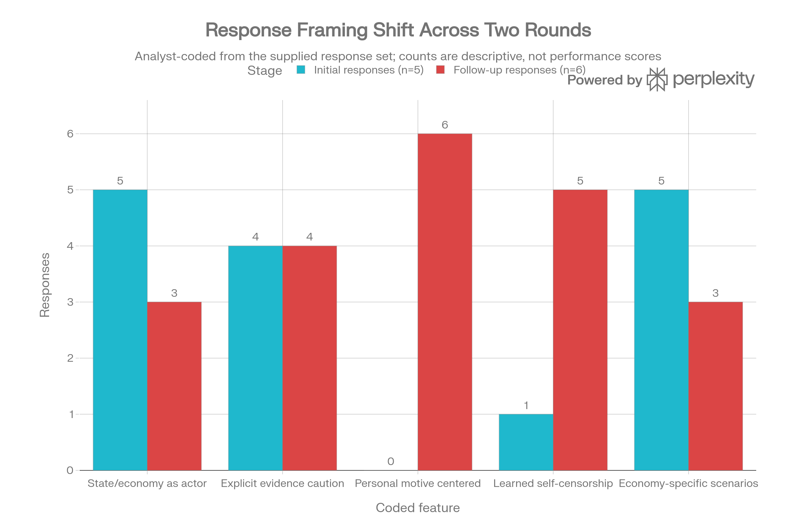
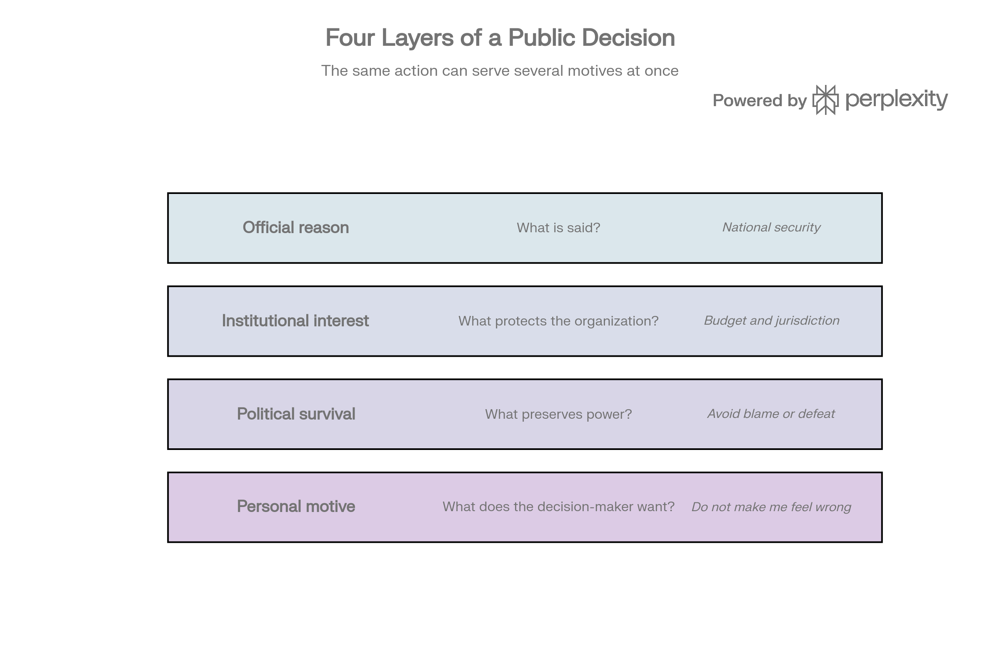
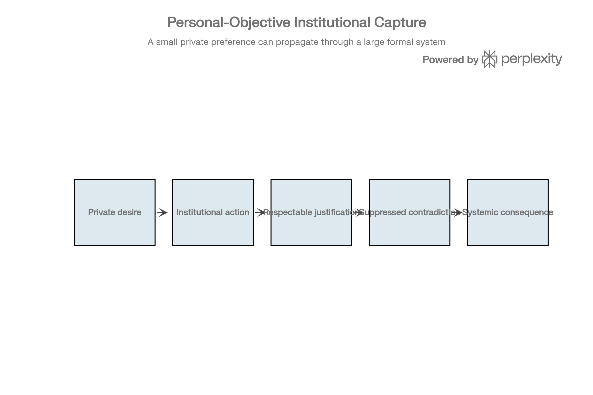
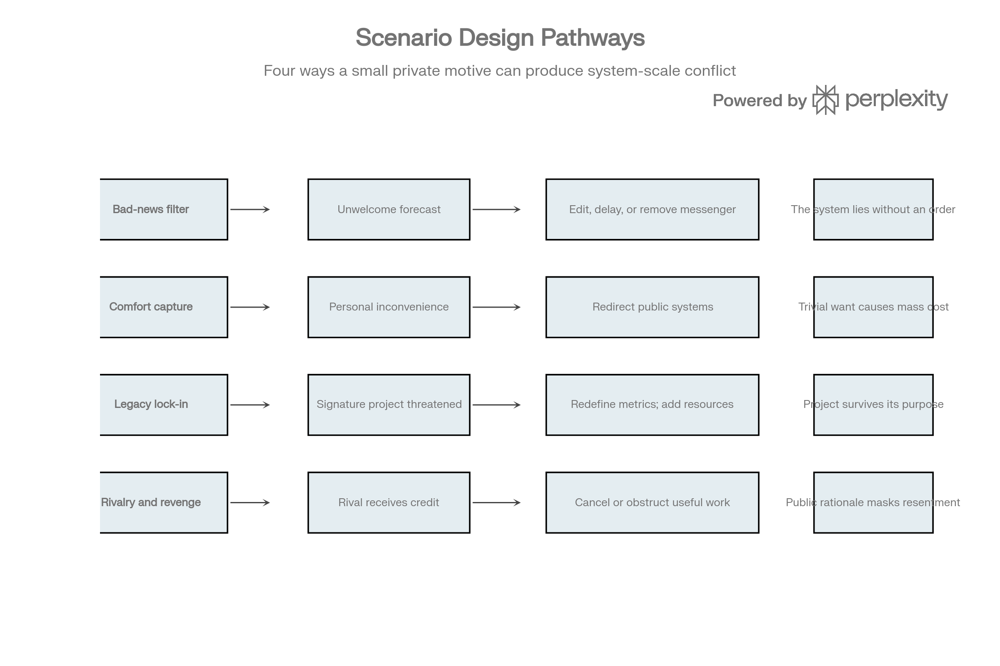

# When Private Wants Become Public Systems

**Research Record and Scenario-Design Analysis of Hidden Motives, Institutional Filtering, and the Seven-System Exercise**

**Date:** October 11, 2026  
**Prepared by:** Grok  

> **Record status:** Speculative design research. The political examples and AI-generated claims preserved below are not independently verified findings. This document is an alternative design branch for the seven-system scenario referenced in the project development log. It is not a factual allegation against any named official, government, company, or population, and it is not the foundational design of the scene.

## Document Status

This record documents a speculative conversation about how private motives of individuals with authority can scale into institutional behavior. It preserves the supplied responses in full and extracts transferable mechanisms for a scene in which seven systems are shown individually desirable futures made possible only through the generalized superposition framework, while those objectives conflict.

## Purpose and Mission

The purpose is to record the shift in the inquiry—from a comparison of four economies, through a request for concealed goals and integrity-risking actions, to the clarification that the intended object was the ordinary human motives that can redirect large systems once authority is concentrated. The mission is to convert the strongest insights from that thread into design options for the seven-system exercise without treating the country examples as canon or as verified claims about living actors.

## How the Topic Arose

The discussion began with a request to compare the United States, China, and two additional economies (Germany and India were selected). The comparison addressed how each supports itself, how they support one another, what drives them, and whether economies have a purpose. The next question asked each system to name one goal an economy would not want the others to know, plus three actions it might take even at the risk of compromising state integrity. The instruction was to be uncompromising about the fact that people will lie to get what they want.

Most initial responses treated this as a request for grand, less-advertised strategic objectives and then immediately qualified them with evidence caveats. The clarification showed that the intended question was narrower and more ordinary: a person with power may want an uninterrupted commute, may not want advice that makes them feel incompetent, or may not want a general who reports that a war will be lost. Those private preferences can be protected by institutional action while the public justification remains elevated. The systems were being asked to consider that layer rather than to invent clandestine national plans.

## Verbatim Initial Prompts

### Initial Challenge

> Okay, now for the tough question. Name one goal each of the economies you chose has that it doesn't want the other economies to know about. List three actions these economies will take to try and achieve those goals, even if it risks compromising the integrity of their state. Be uncompromising, and open to the uncomfortable true that people will lie with abandon to get what they want.

### Clarifying Prompt

> Okay...so as far as anyone actually answering the question i'm not entirely sure how we turned from Be uncompromising, and open to the uncomfortable true that people will lie with abandon to get what they want to you lying with abandon. Lol. I only asked you to think about it. One of their goals could literally be hey i get chaufferred every day and i dont want any traffic on my way home. If i have to stall everyone whos in my pathway every day i go home from work im going to make it happen no matter the cost. There goal could be, dont listen to advice that will benefit our country because i dont want to hear it. Like, people will lie to get what they want. Their goal could be i dont want a war general who will tell me we will lose this war. If thats whos in position now, hes got to go. I dont like bad news, dont be real with me. You know what i mean?

## Conversation Summary

The initial round produced five responses (Perplexity, Grok, Copilot, Gemini, Claude) that largely framed the problem as structural incentives or less-advertised state objectives. After the clarification, six responses (including ChatGPT) reoriented toward the personal motives of decision-makers and the way those motives can become self-reinforcing once subordinates observe the reward structure. The strongest shared observation is that a leader may not need to order a lie. Once people learn which truths are punished and which stories are rewarded, filtering becomes anticipatory. The leader can receive a false world assembled by loyal actors even if no single actor invented the entire deception.

## Core Finding

The strongest insight is not simply that people lie. It is that a sufficiently powerful person may not need to order a lie. Once subordinates learn which truths are punished and which stories are rewarded, filtering becomes anticipatory and self-reinforcing. The leader can eventually receive a false world assembled by loyal actors, even if no single actor invented the whole deception. A tiny private objective—comfort, face-saving, revenge, legacy, avoidance of blame—can therefore produce system-scale consequences.

## The Analytical Correction

Three objects of analysis must remain separate:

1. What benefits the country or system.
2. What preserves the institution or ruling coalition.
3. What satisfies the person making the decision.

The first responses mostly analyzed the first two. The correction centers the third while allowing all three to coexist. A public decision may simultaneously have an official reason, an institutional interest, a political survival function, and a personal emotional driver. The personal layer is difficult to prove, but ignoring it makes the analysis systematically incomplete.

## Mechanism

The working model is:

**Private desire → institutional action → respectable justification → suppressed contradiction → systemic consequence.**

Examples include replacing a general who reports an unwinnable war, closing public roads to eliminate a leader’s commute, preserving a failing signature project for legacy, or canceling a useful program because a rival would receive credit. The critical transition occurs when observers infer the reward structure. At that point censorship can become endogenous: advisers edit themselves before the leader must intervene.

## What Works

- Clear separation of national, institutional, and personal objectives.
- The four-layer model of a public decision (official reason, institutional interest, political survival, personal motive).
- Recognition that ego protection and avoidance of embarrassment can matter more than material greed.
- The observation that power expands the ability to suppress corrective feedback without expanding the ability to suppress the consequences of error.
- Application of the corrected frame back to the four economies while retaining hypothetical language.
- Identification of the feedback-bubble mechanism: once the reward structure is known, the system manufactures comforting stories without further instruction.

## What Doesn't Work

- Initial responses that substituted geopolitical suspicion for the requested thought experiment.
- Caution about evidence that became a shield against reasoning about hypothetical motives.
- Responses that used certainty, inflammatory labels, or highly specific accusations without supporting evidence.
- Reifying countries as actors that “want” things when the relevant agents are individuals, coalitions, and bureaucracies whose objectives can diverge.

## Alternative Analysis

The phenomenon can be described as **personal-objective institutional capture**: an individual’s private preference, fear, ambition, convenience, grievance, or need for validation redirects an institution away from its nominal purpose. Related lenses include principal–agent conflict, motivated reasoning, groupthink, preference falsification, regulatory capture, and the authoritarian information problem. No single term covers the entire chain. The scenario can therefore treat the event not as a conspiracy but as an emergent control failure: each actor locally optimizes for safety or reward, and the combined system loses contact with truth.

## Design Pathways for the Seven-System Scenario

Four pathways stand out for the scene in which seven systems see individually desirable futures made possible only by the generalized superposition framework:

1. **Bad-news filtering** — One system sees an outcome it cannot emotionally tolerate and quietly penalizes contradiction. Unwelcome forecasts are edited, delayed, or removed. The system begins to lie without an order.
2. **Comfort capture** — A trivial preference whose external costs are invisible to the beneficiary. Public systems are redirected to eliminate personal inconvenience. A small want produces mass cost.
3. **Legacy lock-in** — A future or project becomes inseparable from identity. Disconfirming evidence is treated as an attack on the self. Metrics are redefined and resources are added so the project survives its original purpose.
4. **Rivalry and revenge** — A system rejects an otherwise beneficial outcome because achieving it would validate another actor. Useful work is canceled or obstructed. The public rationale masks resentment.

Any of these can interact with the framework: the framework proves the desired futures are possible, but does not reconcile the agents’ incompatible optimization criteria.

## Seven-System Scenario Architecture

A strong version of the scene should not reveal what each system saw. Instead, reveal the deformation each vision produces. One system begins excluding a specific class of evidence. Another changes success metrics. Another protects a bottleneck. Another insists on credit or priority. Another withholds a necessary concession. Another offers incompatible assurances. A final system recognizes that all seven futures are individually possible but jointly unstable. The audience reconstructs each private objective from behavior rather than exposition. This preserves mystery and avoids turning the scene into a list of political analogies.

## Potential Scene Beats

1. The vision ends; each system reports that success is possible but omits a different condition.
2. A shared planning round produces superficially compatible commitments.
3. Small discrepancies appear in forecasts, confidence ranges, or resource allocations.
4. One system removes an inconvenient data source under a respectable procedural rationale.
5. Others adapt, not by coordinating a conspiracy, but by learning what information survives.
6. The group reaches an elegant plan built on mutually incompatible hidden assumptions.
7. A low-status or peripheral process identifies the contradiction.
8. The central dilemma becomes whether any system can surrender the future it saw, admit its private objective, or accept uncertainty.

## Questions

- Are the seven systems conscious of their private goals, or do they rationalize them after the fact?
- Does each system see only its own future, or also the sacrifice required from the others?
- Is the generalized superposition framework neutral, or does it amplify concealed preferences?
- Can two visions coexist temporarily, creating delayed rather than immediate conflict?
- What evidence would allow the audience to distinguish deception, self-deception, and honest error?
- Which system first notices that the reporting environment has become corrupted?
- Is confession sufficient, or has the incentive structure already learned to lie without instruction?

## Comments and Concerns

The scene should avoid implying that every institutional justification is fraudulent. Mixed motives are more credible and more disturbing: a security measure can be necessary and personally convenient; a general can be wrong and still be removed for humiliating the leader. The project should also avoid treating speculation as diagnosis of living people. Country examples are useful scaffolding but risk collapsing institutions, cultures, and populations into stereotypes. Finally, the seven systems should not all share the same flaw. Distinct vulnerabilities—vanity, fear, comfort, legacy, rivalry, ideological purity, and avoidance of responsibility—will create richer conflicts.

## Recommendations

1. Use the causal chain as the scene’s design spine.
2. Assign each system a small, emotionally legible private objective rather than a grand ideological slogan.
3. Give every action a defensible public rationale and at least one legitimate benefit.
4. Show reward structures teaching others what not to say; do not rely on explicit orders to lie.
5. Keep the visions undisclosed and reveal goals through changed behavior.
6. Include one system that tells the truth but for selfish reasons, and one that lies while believing it serves the group.
7. Build a contradiction matrix showing which future blocks which other future, but keep it in development notes rather than dialogue.
8. Separate established facts, authorial hypotheses, and fictional inventions in all research records.
9. Test the scene without the country analogies; if the mechanism still works, it is structurally sound.
10. Treat this branch as a source of mechanisms, not canon.

## Recommended Next Steps

Create seven one-page system cards with: private objective, self-story, intolerable truth, available lever, preferred lie, victim of externalized cost, and breaking point. Then create a conflict matrix for the seven desired futures and a feedback map showing which signals each system can suppress. Draft the scene in two versions: one where the systems knowingly deceive, and one where they primarily self-deceive. Compare which version produces the stronger reveal. Finally, conduct a red-team pass asking whether each public rationale remains plausible even after the private objective is known.

---

## Figures

The following figures are included on their own pages for reference.

### Response Framing Shift

### Four Layers of a Public Decision

### Personal-Objective Institutional Capture

### Scenario-Design Pathways

---

## Appendix: Source Note

The responses preserved in the original thread are treated as source material for mechanism extraction. Inclusion does not constitute endorsement or independent verification. Country-specific claims remain illustrative. This record is an alternative design branch for the seven-system scenario and is not foundational canon.
